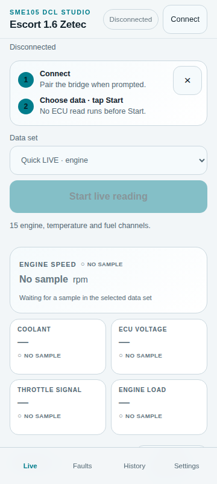
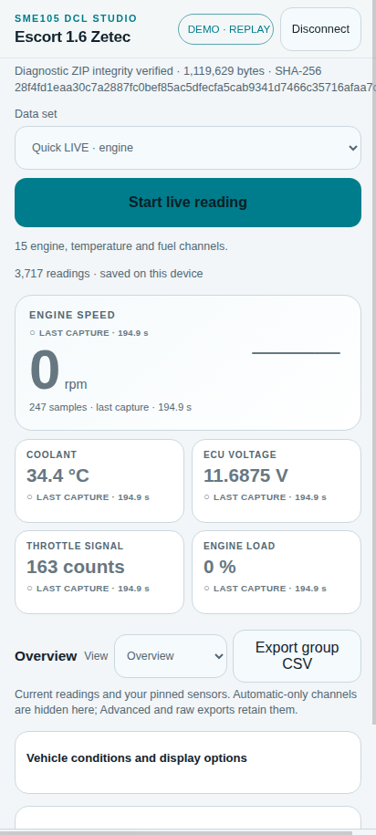

# SME105 DCL Studio

[](https://github.com/0Maxbon0/sme105-dcl-studio/actions/workflows/ci.yml)

**Independent research for understanding and preserving Ford EEC-IV diagnostics.**

**Android application + ESP32 diagnostic bridge + Python analysis**, built around a European **1998 Ford Escort 1.6 Zetec-E** and its EEC-IV SME-105 PCM (`97AB-12A650-KA`). The emphasis is on **raw evidence, reproducible experiments and explicit uncertainty**, not guesswork or unsupported claims of official ECU compatibility.

**[Engineering brief for Ford / OEM reviewers](docs/ENGINEERING_BRIEF.md)** · [Architecture](#architecture) · [Software quick start](#build-and-run) · [Protocol research](docs/protocol-notes.md) · [Contribute](CONTRIBUTING.md)

> [!IMPORTANT]
> **Experimental research, not a certified diagnostic product.** An isolated Android↔ESP32 bench demonstration does not establish vehicle-bus electrical compatibility, ECU command acceptance, sensor identities, actuator safety, or road-use readiness. Never interact with the app while driving. This project is independently developed and **not affiliated with, endorsed by or supported by Ford Motor Company**.

## Why this project matters

Legacy EEC-IV vehicles are difficult to diagnose with modern tools. References for Ford's Diagnostic Communication Link (DCL) can be incomplete or strategy-dependent, and plausible sensor-like numbers need independent validation. This project builds an auditable chain from **timestamped raw bytes → persistent capture → reproducible decoder → evidence-classified interpretation**.

| Engineering discipline | What is demonstrated |
| --- | --- |
| **Embedded / real-time** | ESP32 UART capture, MAX487 interface, bounded telemetry ring, transmission safety gates |
| **Android / networks** | Capacitor Android application, direct WPA2 SoftAP, authenticated TCP, heartbeat and reconnect handling |
| **Data integrity** | IndexedDB archive, RX/RXB sequence replay, deduplication, explicit gap records and WebView recovery |
| **Reverse engineering / testing** | Python DCL tooling, host simulation, JVM/Node/Python tests, experimental command and sensor research |

## Application preview

<table><tr>
<td align="center"></td>
<td align="center"></td>
</tr><tr><td align="center"><sub>Live data interface</sub></td><td align="center"><sub>Recorded data / replay</sub></td></tr></table>

*Historical interface screenshots. They are not evidence that the latest recovery revision or every interpreted sensor has been physically validated.*

## Software verification snapshot — 11 November 2026

The latest changes improve connection resilience and Live Data recovery. The engineering verification report records **298 JavaScript tests passed / 3 skipped**, **307 Python tests passed / 10 skipped**, **10 Android JVM unit tests passed**, plus successful Wi-Fi and BLE ESP32 firmware builds. These are **software / host verification results**, not road or vehicle acceptance. Consult the [GitHub Actions workflow](.github/workflows/ci.yml) for independently run public CI and the [stability report](docs/wifi_ble_stability_and_rf_report.md) for detailed limitations.

| Capability | What is actually established |
| --- | --- |
| Phone ↔ ESP32 direct Wi-Fi | Demonstrated on an isolated bench on **9 Nov 2026** |
| Connection recovery / telemetry replay | Implemented and host-tested; **current implementation not yet physically soak-tested** |
| Buffered RX evidence | **8,000 packed × 5-byte events** = 40,000 bytes of event data |
| Recovery duration | 30 s session reconnect grace; not 30 s guaranteed lossless data (≈8.3 s at 960 bytes/s) |
| EEC-IV data maps and high-idle root cause | Research hypotheses; **not independently OEM-verified** |

See the [high-idle diagnostic reasoning](docs/high-idle-diagnosis.md), [protocol research](docs/protocol-notes.md) and [OEM-oriented engineering brief](docs/ENGINEERING_BRIEF.md).

## Last physically demonstrated bench baseline — 9 November 2026

| Component | Current baseline | Evidence |
| --- | --- | --- |
| Android application | **v1.8.17**, build code **19**, native Capacitor/Android | Debug APK built and installed on Samsung Galaxy A52s with app data retained |
| ESP32 bridge | **Firmware v29**, PlatformIO environment `esp32dev` | Flashed to `app0`, digest verified, USB `STATUS ... fw=29` and idle state checked |
| Direct link | ESP32 **WPA2 SoftAP** → Android; **no router or Internet** | Owner confirmed direct phone pairing and bench-output indicator response with ECU disconnected |
| Security | **One user-visible Wi-Fi passphrase**; no separate token field | Native Keystore storage; 16-byte PBKDF2-derived TCP `AUTH` still required by firmware |
| Evidence and captures | Persistent Android IndexedDB; archived raw captures | `adb install -r` preserved existing WebView data; historical captures are untouched |
| Vehicle ECU command behavior | **Not certified by this release** | Requires separately approved, timestamped, raw vehicle-session evidence |

**Live link:** Existing bridge SSID `SME105-DIRECT-2BF8`; `10.77.13.1:8765`, WPA2, one client. The name is configurable on other boards; use the SSID shown by the actual ESP32. Never commit real Wi-Fi passwords, legacy authorization tokens, private NVS dumps, or Android backups.

See the [November 9 direct-link bench release notes](docs/releases/2026-11-09-direct-softap-bench.md) for deployment/rollback boundaries. The owner-reported bench demonstration is a useful *bridge/output* acceptance milestone, not evidence that an actuator or vehicle ECU executed a command. The hardware's `DE=LOW`, `auto_tx=0`, idle state and fail-closed command gates remain the baseline. Android network lifetime on this device can be affected by Android's **no-Internet** Wi-Fi policy; long-duration stability and road-use were not separately certified.

## Architecture

```text
Android SME105 DCL Studio (offline-capable native application)
    │  Android Wi-Fi NetworkSpecifier (local-only WPA2; no router)
    ▼
ESP32 SoftAP  SME105-DIRECT-2BF8 / 10.77.13.1
    │  TCP 8765, authenticated session, session-bound writes
    ▼
ESP32 v29 DCL bridge ── USB 115200 for trusted setup & status
    │  TX2_BENCH + explicit ARM/READ gates; no auto vehicle transmission
    ▼
MAX487 interface → target vehicle DCL bus **only after electrical qualification**
```

Android uses a single passphrase for joining the ESP32 network and deriving the session's existing `AUTH` token internally (PBKDF2-HMAC-SHA256 with a device SSID-bound salt). The passphrase is protected using Android Keystore-backed private storage and is **never** a source constant or Git credential. Firmware NVS contains the current AP profile in one atomic bundle; the old AP credentials remain intact for physical rollback. **WPA2 and TCP authorization share a secret** in this one-password model: anyone with that passphrase may become an authenticated bridge client, so it must be kept private. `AUTH` does not bypass individual ECU arming requirements.

Legacy BLE is available as a separate `esp32dev_ble` firmware build, **not** simultaneous Wi-Fi+BLE in the same image. Previous STA/router functionality remains in firmware for compatibility but is not the primary phone workflow.

## Build and run

### Prerequisites

- Node.js **22**, Java **JDK 21**, Android SDK and platform tools (target SDK 36).
- Python **3.12+** with `pyserial` and PlatformIO (supported project environment); an ESP32 development board with CP2102 and a suitable USB cable.
- Physical USB access and an **isolated bench** for firmware provisioning. Do not attach the vehicle bus for the Wi-Fi acceptance checks.

Clone the repository and run:

```bash
npm ci
npm test
npm run android:sync
cd android && ./gradlew :app:testDebugUnitTest :app:assembleDebug --offline
```

On Windows use `gradlew.bat` in place of `./gradlew`. The debug APK is produced at `android/app/build/outputs/apk/debug/app-debug.apk`. Upgrade an existing install **without erasing its data**:

```bash
adb install -r android/app/build/outputs/apk/debug/app-debug.apk
```

Build the correct Wi-Fi firmware from the repository root:

```bash
python -m pip install -e '.[firmware]'
python -m platformio run -d firmware/sme105_usb_bridge -e esp32dev
```

`./.venv/bin/pio` is equivalent when using the existing project venv. For an already-provisioned board, use the explicitly authorized physical-USB rekey workflow *only if changing its saved AP password*:

```bash
python scripts/sme105_wifi_setup.py --ap --ap-rekey --port /dev/ttyUSB0
```

The utility asks for the password privately; it must not be supplied on the command line. A plain `--ap` refuses to overwrite a saved profile. **Do not invoke `WIFI_FORGET`, erase NVS, or flash `esp32dev_ble` to fix a Wi-Fi password problem.** Follow [direct Wi-Fi setup and recovery](docs/wifi_bridge_architecture_and_setup.md) for backups, verification and first-time provisioning.

### Connecting a phone

Open **Settings → Wi-Fi Bridge** in the installed Android app, confirm the actual AP SSID, and enter/save the one WPA2 passphrase. Press **Connect**, accept Android's local-network permission prompt if shown, and keep the phone connected to this **no-Internet** Wi-Fi network. The app checks `AUTH`, `HELLO`, `PINS` and `STATUS` before reporting the bridge ready. No extra token entry is necessary. Do not initiate a vehicle read as a Wi-Fi connectivity test.

## Repository map

| Path | Responsibility |
| --- | --- |
| [`app/`](app/) | **Canonical Android application UI**: HTML/CSS/JavaScript assets bundled by Capacitor; **do not delete as an “old website”** |
| [`android/`](android/) | Native Android integration and authenticated Wi-Fi transport, unit tests, APK build files |
| [`firmware/sme105_usb_bridge/`](firmware/sme105_usb_bridge/) | ESP32 v29 Wi-Fi bridge firmware and hardware safety gates |
| [`scripts/`](scripts/) | USB provisioning, command tools and engineering utilities |
| [`src/ford_dcl/`](src/ford_dcl/) | Python capture/inspection CLI and offline analysis |
| [`tests/`](tests/), [`app/tests/`](app/tests/) | Automated Python and JavaScript regression suites |
| [`captures/`](captures/) | Preserved, immutable historical RAW evidence — **do not edit or delete** |
| [`docs/`](docs/) | Engineering analysis, protocol notes, electrical safety, setup and evidence-based findings |
| [`artifacts/`](artifacts/) | Historical reports and selected visual evidence (not a current installation channel) |

The obsolete, separate Python localhost GUI is retired from the active project. `app/` remains essential to the native APK; removing it would break the current Android application. This repository does not currently publish an active GitHub Pages website.

## Verification and evidence policy

The **9 November** device/bench baseline reported JavaScript **273 passed / 3 skipped**, Python **297 passed / 10 skipped** locally (public clean checkout: 293 pass / 14 skipped), and Android / Wi-Fi firmware builds passing. The later **11 November** source-recovery verification is summarized above. Both sets are dated observations, not evergreen certification; rerun tests on the exact source revision being reviewed. Tests requiring unavailable private capture fixtures intentionally skip.

**Evidence levels must never be conflated:**

- **Observed:** a preserved raw recording or directly witnessed bench/vehicle behavior with the stated setup.
- **Reference:** an identified external source, *not* automatic support for this specific ECU.
- **Inferred:** a testable hypothesis from patterns or comparisons.
- **Unknown:** untested, ambiguous or not established on the target ECU.

The command catalogue, DTC variants, MEM offsets, reverse-engineered words, PID/DMR maps, sensor conversions and active-control candidates must retain their own evidence status. The ability to build a command is **not** proof that the ECU accepts it. Historic raw material and metadata are append-only; corrections should be reproducible derivatives with source hashes.

## Safety boundary

There is **no generic “write arbitrary ECU bytes” API**, and no automatic ECU transmission at boot, Wi-Fi connection or recovery. Named `ARM_*` and `READ_*` transactions are bounded and require the documented per-boot `TX2_BENCH` pad verification; `DE` defaults LOW. No KOEO, KOER, live, MEM, clear-DTC, idle/actuator or output commands should be dispatched without an explicit, appropriate vehicle test procedure and operator authorization. A local LED lighting during a bridge-only test does not establish electrical compatibility with the vehicle.

Start with the [engineering brief for technical reviewers](docs/ENGINEERING_BRIEF.md), [wiring and electrical safety](docs/wiring-safety.md), [experiment matrix](docs/sme105-dcl-experiment-plan-2026-11-07.md), [protocol notes](docs/protocol-notes.md), and [reference index](docs/REFERENCES.md). The [technical Wi-Fi setup](docs/wifi_bridge_architecture_and_setup.md) documents the current one-password architecture, USB-only rekey and rollback boundaries. Historical delivery reports are retained as dated records; **they do not supersede the current release table**.

## Project governance

Reports about protocol behavior should include the exact ECU, firmware/app versions, USB or radio mode, safety state, original capture identifier, clock settings, raw digest, and steps to reproduce. Keep sensitive phone, vehicle, Wi-Fi and NVS data out of public issues. See [contributing](CONTRIBUTING.md), [security](SECURITY.md) and the [references](docs/REFERENCES.md).

**Licensing:** The repository is publicly visible but does **not** have an open-source license yet. Viewing source code does not grant permission to modify or redistribute it. The maintainer must deliberately select and add a license before this project can be described as open source.
