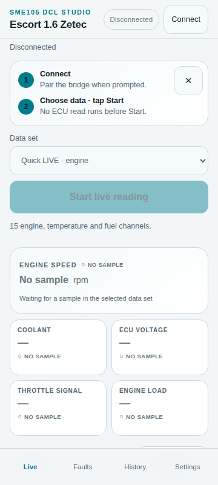
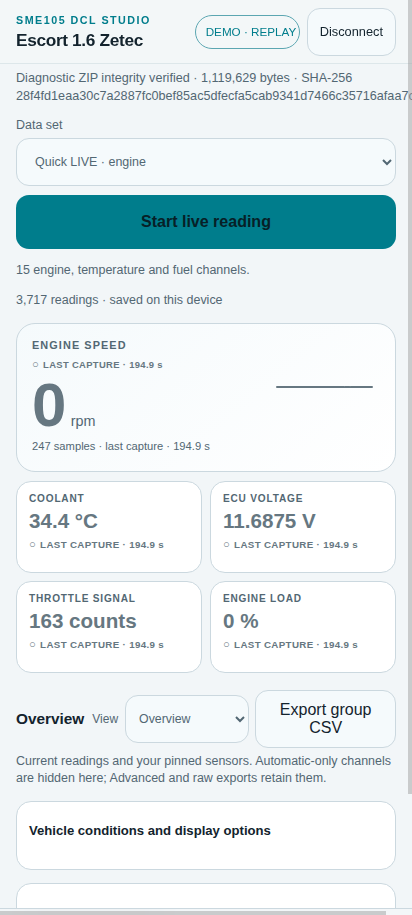
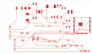

# EscortScope — Ford Escort diagnostics by Basita

[](https://github.com/0Maxbon0/sme105-dcl-studio/actions/workflows/ci.yml)

**An independent Android + ESP32 research platform for exploring legacy Ford EEC-IV diagnostics—carefully, reproducibly, and with raw evidence.**

Built around a **1998 European Ford Escort 1.6 Zetec-E** and an **EEC-IV SME-105** PCM (engineering number `97AB-12A650-KA`). The methodology, transport engineering and test tooling are intended to be useful beyond this particular vehicle.

**[Engineering brief](docs/ENGINEERING_BRIEF.md)** · [Architecture](docs/ARCHITECTURE.md) · [Hardware and components](docs/HARDWARE_GUIDE.md) · [How the code works](docs/CODE_WALKTHROUGH.md) · [Quick start](#get-started-without-a-vehicle) · [Documentation index](docs/README.md)

> [!IMPORTANT]
> **Experimental engineering project—not a certified diagnostic tool.** Network and isolated bench demonstrations do not prove vehicle-bus electrical compatibility, ECU command acceptance, sensor identities, actuator safety or road-use readiness. Do not operate the app while driving. This project is independently developed and **is not affiliated with, endorsed by or supported by Ford Motor Company**.

## Why this project exists

Many older EEC-IV vehicles have limited support in modern diagnostic ecosystems. Command formats, PID meanings and ECU calibration details can vary. A plausible-looking value is not the same as a verified sensor reading.

EscortScope, developed by Basita, is an effort to build a transparent chain from **raw bytes → timestamped capture → reproducible parser → evidence-qualified interpretation**. Rather than treating reverse-engineering hypotheses as established manufacturer specifications, each finding is labeled *Observed*, *Reference*, *Inferred* or *Unknown*.

**Identity:** an independent automotive product by Basita (بسيطة), with a steel-blue automotive action/vehicle identity, official Basita Canvas/Ink surfaces, Lagoon/Mineral selection colors, typography, spacing, controls, semantic colors and motion. See [identity and migration notes](docs/BRANDING_RELEASE.md).

### What it demonstrates

| Engineering area | Implemented work |
| --- | --- |
| **Embedded / real-time** | ESP32 UART bridge, MAX487 interface, time-bounded transmission gates, raw telemetry ring and bounded replay |
| **Android / networking** | Native Capacitor application, local-only WPA2 SoftAP, authenticated TCP, heartbeat and reconnect lifecycle; separate BLE build |
| **Data reliability** | IndexedDB raw archive, sequence-aware RX/RXB, duplicate suppression, inclusive loss reporting and crash recovery |
| **Protocol research** | Ford EEC-IV DCL experiments, Python capture tools, host simulation, and testable candidate sensor conversions |
| **Testing / engineering discipline** | Node.js, Python, JVM and PlatformIO checks, safety invariants and documented hardware-vs-simulation boundaries |

## Application preview

<table>
  <tr>
    <td align="center"></td>
    <td align="center"></td>
  </tr>
  <tr><td align="center"><sub>Live telemetry view</sub></td><td align="center"><sub>Captured-data replay view</sub></td></tr>
</table>

*These are historical application screenshots, not a claim that the latest build or every displayed sensor mapping has been validated on a vehicle.*

## Current engineering status

**Current release (26 November 2026):** Android **v2.2.0** (build **30**) and ESP32 firmware **v30**. EscortScope was installed in place on a Samsung Galaxy A52s; the original package identity and saved recordings were retained. The compact live dashboard exposes readings earlier and offers direct data-set selection. All application select lists now use the branded choice sheet; saved recordings support grouped dates, search and status/reading filters. The startup screen follows actual initialization and the original Basita Unravel credit loops silently every 7.63 seconds in both themes.

**Physical bridge validation:** v30 BLE was flashed and verified by USB. With the ECU disconnected, the phone completed TX2 self-test and reached the initial DCL transmission. The former v29 BLE output reservation could never fit in its 4 KiB queue. v30 reserves a bounded report in an 8 KiB queue without bypassing electrical safety gates. Vehicle ECU response remains unverified.

**Software checks:** see the [current release notes](docs/BRANDING_RELEASE.md), [developer setup](docs/DEVELOPER_SETUP.md) and [GitHub Actions CI](.github/workflows/ci.yml). Both ESP32 profiles compiled; Android debug assembly and in-place installation passed. The earlier November 9 Wi-Fi demonstration and November 11 recovery verification remain historical observations, not current on-vehicle acceptance.

| Capability | Evidence level / limitation |
| --- | --- |
| Direct Android ↔ ESP32 Wi-Fi | **Bench demonstrated** on 9 November 2026; no router or Internet required |
| Live Data reconnect/resume | **Host-tested**; hardware RF/thermal soak and on-vehicle behavior not yet established for the new implementation |
| Recovery grace | Up to **30 s** to reconnect; not a promise of 30 s lossless telemetry |
| Telemetry history | **8,000 × 5 bytes** of raw events; ~8.3 s at a continuous 960-byte/s stream, longer at lower rates |
| EEC-IV commands, sensors and scaling | **Research in progress**; target-ECU mappings require independent confirmation |
| High-idle / VSS investigation | [Diagnostic hypotheses and validation limits](docs/high-idle-diagnosis.md), **not a confirmed ECU defect** |

A dated [physical direct-link bench report](docs/releases/2026-11-09-direct-softap-bench.md) documents the previously observed bridge connection. It must not be mistaken for field validation of the subsequent November 11 recovery changes.

## Architecture

```text
Android app (Capacitor / JavaScript / IndexedDB)
    │ Native Android Wi-Fi NetworkSpecifier + WPA2
    │ Local-only TCP :8765, session authentication
    ▼
ESP32 SoftAP (10.77.13.1 / default SSID: SME105-DIRECT-2BF8)
    │ Wi-Fi and BLE are separate firmware profiles
    │ Heartbeat, 30 s retained-session grace, bounded RX replay
    ▼
ESP32 EEC-IV DCL bridge firmware (PlatformIO, v30)
    │ USB serial for trusted provisioning and bench diagnostics
    │ Explicit per-boot TX2_BENCH + ARM/READ gates
    ▼
MAX487 electrical interface → vehicle DCL bus
    ONLY after separate electrical and procedural qualification
```

Network authentication uses an owner-entered WPA2 passphrase and its SSID-bound PBKDF2-derived session token. This is **one shared secret**, not two independent authentication factors. On Android, private credential handling uses Keystore-backed storage. No vehicle transmission occurs merely because a device connects or reconnects.

See [full architecture](docs/ARCHITECTURE.md), [Wi-Fi setup](docs/wifi_bridge_architecture_and_setup.md), [wiring and electrical safety](docs/wiring-safety.md), [code walkthrough](docs/CODE_WALKTHROUGH.md), and [firmware overview](firmware/README.md).

## Hardware — assembled bridge vs. PCB concepts

The current research bridge uses an **ESP32 DevKit-class board**, **5 V MAX487 transceiver**, receive-line **5 V → 3.3 V translation**, hardware **DE pull-down**, and USB/separately protected bench power. This is different from the **KiCad PCB R0 and compact R1** designs. R1 is a 95 × 60 mm, four-layer **review-only design** with provisional automotive power protection, regulator choices and an ESP32-WROOM-32UE module. It has **not been fabricated or vehicle-qualified**.

[Parts, GPIO map and connector caveats](docs/HARDWARE_GUIDE.md) · [KiCad design workspace](hardware/README.md) · [R1 review status](hardware/pcb-r1/REVIEW_STATUS.md)



*PCB visual is a design preview only. Passing ERC/DRC does not make a board safe to connect to an ECU.*

## Get started without a vehicle

The fastest useful evaluation is **software-only**: clone the repository, execute parsers/tests and examine the source. **You do not need an ECU, car, connected ESP32 or private diagnostic captures** for the public baseline tests (capture-dependent tests may skip).

### Requirements

- Node.js **22** and npm
- Python **3.12+** for the documented development/test environment
- Optional: JDK **21** and Android SDK for APK builds
- Optional: PlatformIO and a compatible ESP32 board for firmware development

```bash
git clone https://github.com/0Maxbon0/sme105-dcl-studio.git
cd escort-sme105-diagnostic-lab
npm ci
npm test
python -m pip install -e .
PYTHONPATH=src python -m unittest discover -s tests -q
```

Optional **compile-only** checks (no device flash):

```bash
python -m pip install -e '.[firmware]'
python -m platformio run -d firmware/sme105_usb_bridge -e esp32dev
python -m platformio run -d firmware/sme105_usb_bridge -e esp32dev_ble
```

For Android development:

```bash
npm run android:sync
cd android
./gradlew :app:testDebugUnitTest :app:assembleDebug
```

On Windows, use `gradlew.bat`. The resulting *debug* APK is at `android/app/build/outputs/apk/debug/app-debug.apk`. This README does **not** recommend connecting to the vehicle or installing experimental firmware as a first test. Provisioning and rollback are described separately in [technical setup](docs/wifi_bridge_architecture_and_setup.md).

## Repository guide

| Path | Purpose |
| --- | --- |
| [`app/`](app/) | Canonical Android WebView application and offline UI, **not** an obsolete website |
| [`android/`](android/) | Native Android plugins, transport lifecycle and JVM tests |
| [`firmware/sme105_usb_bridge/`](firmware/sme105_usb_bridge/) | ESP32 Wi-Fi/BLE builds, ring replay and hardware protection |
| [`src/ford_dcl/`](src/ford_dcl/) | Python capture and offline inspection CLI |
| [`tests/`](tests/) / [`app/tests/`](app/tests/) | Host, parser, transport and recovery regression suites |
| [`docs/`](docs/) | Guided docs index, architecture, hardware, research references, experiment logs and safety |
| [`hardware/`](hardware/) | Review-only editable KiCad PCB R0/R1 concepts, separate from the hand-wired prototype |
| [`artifacts/`](artifacts/) | Dated visual/test artifacts, **not** an APK distribution channel |
| [`captures/`](captures/) | Historical research evidence; treat raw samples as potentially sensitive |

The retired Python localhost GUI is not the supported user interface. The Android app's canonical web assets live under `app/`.

## Research integrity and safety

- **Observed** means an explicitly identified raw capture or witnessed bench/vehicle event; **Reference** means a cited external source; **Inferred** means a testable hypothesis; **Unknown** means unverified.
- A recognized command frame is **not** proof that this ECU accepts the command. A decoded PID-like number is **not** proof of its engineering units.
- There is no general arbitrary ECU-byte write API and no automatic transmit on boot, network connection or recovery. Named operations require safety gates and operator authorization. **Do not use this software as a driving aid or to deliberately reproduce an unsafe engine symptom.**
- Do not publish vehicle-identifying information, passwords, Wi-Fi tokens, NVS dumps, phone backups or sensitive recordings. Existing historical captures are preserved; see [security](SECURITY.md) for responsible reporting.

Explore the [protocol notes](docs/protocol-notes.md), [experiment plan](docs/sme105-dcl-experiment-plan-2026-11-07.md), [references](docs/REFERENCES.md) and [high-idle research](docs/high-idle-diagnosis.md).

For an overview of code internals and safe local builds, read [code walkthrough](docs/CODE_WALKTHROUGH.md) and [developer setup](docs/DEVELOPER_SETUP.md). Before sharing the repository externally, use the [publication checklist](docs/PUBLICATION_CHECKLIST.md).

## For Ford / technical reviewers

The [two-page-style engineering brief](docs/ENGINEERING_BRIEF.md) summarizes the problem, implemented architecture, verification levels, unanswered questions and specific requests for historical EEC-IV documentation or calibration information. The project's intent is to improve maintainability and safe understanding of a legacy vehicle, **not** to imply access to or endorsement by Ford engineering.

## Contributing, security and licensing

Reports should include the exact ECU and firmware/app versions, transport mode, safety state, original capture identifier, clock settings, digest and reproduction steps. Keep identifying raw captures private. See the [wiring and electrical safety guide](docs/wiring-safety.md).

Contributions to parsers, tests, documentation and evidence-based research are welcome. Please read [CONTRIBUTING.md](CONTRIBUTING.md) and [SECURITY.md](SECURITY.md) before sharing files or proposing active hardware experiments.

**License status:** This repository is **publicly viewable but not currently open-source licensed**. Public access alone does not grant reuse, modification or redistribution rights. The maintainer must deliberately select and add a license before describing the code as open source.
