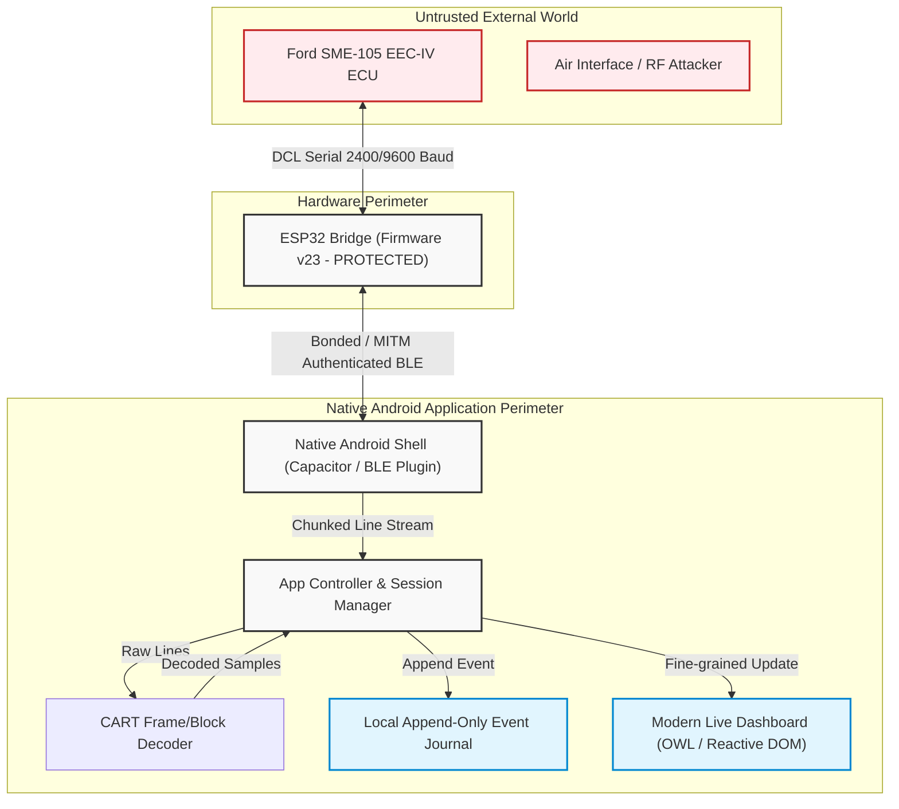
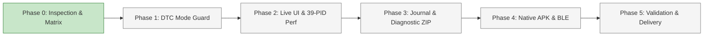

# SME105 DCL Studio — Android Rebuild Acceptance Matrix

**Document Version:** 1.1.0 (Phase 0 baseline plus current verification ledger)
**Date:** 2026-11-05
**Target Vehicle:** 1998 Ford Escort 1.6 Zetec SME-105 (Catch Code `97AB-12A650-KA`), Manual Transmission
**Repository:** `0Maxbon0/sme105-dcl-studio` (`/home/maxim/maximizotech/sme105-fw-review-FORupdGL`)
**Specification Reference:** `/home/maxim/maximizotech/.agent-prompts/sme105-android-luna-max-master-20261105.txt`
**Sensor Reference Standard:** `docs/sensor-reference-verification-2026-11-05.md`
**Governing Roles:**
- **Lead Architect & Implementation Owner:** Codex GPT-6 Luna (MAX Reasoning)
- **Independent Reviewer:** AGY Gemini 3.8 Flash High requested; availability/review result recorded in Section 7. No approval is claimed.

---

## 1. Baseline Evidence and Repository State (Phase 0 Inspection)

### 1.1 Git Working Tree & Commit Baseline
- **Observed Branch:** `fix/live-rx-silence-evidence-20261105`
- **Expected Branch:** `fix/live-rx-silence-evidence-20261105` (Match: **YES**)
- **Observed Commit HEAD:** `8f5cc5433fffa2759ac54d51be35544e10f47264`
- **Expected Commit HEAD:** `8f5cc5433fffa2759ac54d51be35544e10f47264` (Match: **YES**)
- **Working Tree Cleanliness:** Clean at initial inspection; this matrix is now the sole untracked file.
- **Deviation from Requested State:** **NONE**.

### 1.2 Host Tooling & Native Android SDK Baseline
Inspection performed via direct shell queries on the build host:
```bash
which java javac gradle adb android
# Result: None found in PATH
echo "JAVA_HOME=$JAVA_HOME, ANDROID_HOME=$ANDROID_HOME, ANDROID_SDK_ROOT=$ANDROID_SDK_ROOT"
# Result: All empty
ls -ld /home/maxim/Android /home/maxim/.android /usr/lib/jvm/* /opt/*
# Result: No Android SDK, no JDK in /usr/lib/jvm, no Gradle
node -v && npm -v
# Result: Node v22.22.0, npm 10.9.4
```
- **Java / JDK:** java and javac are not on PATH. JetBrains PyCharm JBR 25.0.3+9-329.124 exists at /home/maxim/.local/share/JetBrains/Toolbox/apps/pycharm/jbr/bin/java; it is not validated for Android builds. JAVA_HOME is unset.
- **Android SDK / commandlinetools:** **MISSING** (No `ANDROID_HOME`, `sdkmanager`, or platform-tools).
- **Gradle:** **MISSING** (No system `gradle`; project lacks Gradle wrapper in root).
- **ADB:** **MISSING** (No `adb` binary present).
- **Baseline Tooling Verdict:** Android SDK, Gradle, and ADB are not configured. A Java runtime exists outside PATH. No APK or device validation is claimed.

### 1.3 Baseline Test Suite Execution (`node --test app/tests/*.test.mjs`)
Direct execution output of the existing 48 Node.js test cases:
- **Total Tests:** 48
- **Passed:** 44
- **Failed:** 1
  - `app/tests/controller.test.mjs:67`: `KOEO demo replay keeps code 113 and the firmware block count`
    - `AssertionError [ERR_ASSERTION]: Expected values to be strictly equal:`
    - `+ 'engine off'`
    - `- 'KOEO'`
    - **Root Cause Confirmed:** `app/js/controller.js:59` maps `entry.mode === 0x25` to `"engine off"` when `variant !== "KOER"`, whereas the test at line 83 expects the raw literal string `"KOEO"`.
- **Skipped:** 3
  - `app/tests/recording.test.mjs:30`: `recording chunks retain all rows/raw data, export while active, and survive reopening` (Requires `FAKE_INDEXEDDB_MODULE`)
  - `app/tests/recording.test.mjs:58`: `a failed atomic write stops recording and retains its queued data for export` (Requires `FAKE_INDEXEDDB_MODULE`)
  - `app/tests/recording.test.mjs:75`: `low available storage blocks capture before starting a writer` (Requires `FAKE_INDEXEDDB_MODULE`)
- **Fragile Test Fixture Dependency Identified:**
  - `app/tests/codes.test.mjs:7` reads directly from `/tmp/babroval/eec-iv/resources/EECIVFaults.csv`. While present in `/tmp` during this inspection (allowing `codes.test.mjs` to pass), it is uncommitted and vulnerable to host `/tmp` clearing.

### 1.4 Codebase Architecture Baseline Audit
- **DOM Rendering (`app/js/ui.js`):** Confirmed defect. `ui.js` line 230 calls `cards.replaceChildren()` on every live frame update, destroying and recreating DOM nodes across active streams. Line 201 calls `list.replaceChildren()` for fault code rendering.
- **BLE Transport (`app/js/ble.js`):** Relies exclusively on Web Bluetooth API (`navigator.bluetooth.requestDevice`, GATT connection). Web Bluetooth is **not** supported natively in Android WebViews (Android Chrome WebView does not expose `navigator.bluetooth`). Migration to Capacitor + native BLE plugin is required for native APK.
- **Data Persistence (`app/js/recording.js`):** Confirmed limitation. Stores only raw chunks and CSV strings into IndexedDB (`captures` and `chunks` object stores). It lacks structured lifecycle logging, permission event journals, UI transitions, error traces, crash breadcrumbs, or device/build provenance records.

### 1.5 Real Capture Fixture Inventory & Ground Truth
Physical vehicle captures in `captures/SME105_97AB/` verify the following immutable facts:
1. **0E Stored DTC Capture (`20261104T143804949449Z-usb-bridge.txt`):**
   - Transmits candidate 9600-baud request word 260E (mode 26H).
   - Returns 5 stored DTCs: `122`, `113`, `214`, `157`, `452`.
   - Firmware reports: `EVENT read_armed variant=0E`.
2. **A4 Stored DTC Capture (`20261104T144256788073Z-usb-bridge.txt`):**
   - Transmits distinct candidate 9600-baud request word 26A4 (mode 26H).
   - Returns identical 5 stored DTCs: `122`, `113`, `214`, `157`, `452` in mode 26H.
   - Firmware reports: `EVENT read_armed variant=A4`.
3. **KOEO On-Demand Self-Test Capture (`20261104T154903976737Z-usb-bridge.txt`):**
   - Mode 25H on-demand diagnostic test.
   - Returns single self-test DTC `113` (intake air temperature sensor circuit open/high).
   - Frame 7 status word contains self-test complete flag (`word[0] & 0x40`).
   - Block count: 88 (decoder) / 89 (bridge).
4. **Continuous LIVE Engine-Off Capture (`20261104T160936508451Z-usb-bridge.txt` + `live.csv`):**
   - 3,717 decoded sensor rows across 15 PIDs.
   - `N` (RPM) = 0 constant; `ACT` = `ECT` = 34.4 °C constant; `VBAT` = 11.6875 V; `LOAD` = 0%.
5. **Continuous LIVE Engine-Running Capture (`20261104T161814961794Z-usb-bridge.txt` + `live.csv`):**
   - 3,717 decoded sensor rows across 15 PIDs.
   - `N` (RPM) = 968 to 2640 rpm (median running idle ~992–1084 rpm).
   - `ECT` rises from 35.6 °C to 44.4 °C; `ACT` varies 35.6 °C to 42.2 °C.
   - `VBAT` = 12.5625 V to 13.125 V (running alternator).
   - `FUELPW1` = 960 to 2848 ticks; `LAMBSE1` = 0.921875 to 0.96875.
6. **ALL 39-Channel Capture (`20261104T152920262127Z-usb-bridge.txt`):**
   - 45-slot map, 39 unique PIDs.
   - Confirms automatic transmission PIDs (`BCSDC`, `GR_CM`, `ETVOCM`, `TV_PRES`, `ITOT`, `PDL`) are either zero or static dummy values (`GR_CM=2`).
   - Confirms `MAP`, `MAP_FREQ`, and `EGRDC` are consistently 0 on this manual vehicle.

---

## 2. Architecture & Security Specifications

### 2.1 Trust Boundaries & Fail-Closed Command Contract


#### Inviolable Safety Gates:
1. **Protected Hardware & Firmware v23:**
   - No compiling to flash, flashing, reflashing, factory reset, or partition table modification of the connected ESP32.
   - Firmware v23 DE RMT gate, pad-witness preflight, and automotive TX gate remain untouched.
   - USB access is restricted to read-only diagnostics (`HELLO`, `PINS`, `STATUS`, `OTA_STATUS`).
   - Unit and integration tests must **never** emit active automotive ECU transmit commands to physical serial lines.
2. **Fail-Closed Command Execution:**
   - Any transport interruption, BLE GATT disconnection, framing parity failure, line buffer overrun, or unexpected response mode immediately transitions the session state to `INCOMPLETE` or `FAILED`.
   - Never auto-retry failed vehicle commands.
   - Never auto-rearm transmission upon reconnection.
   - Never automatically clear fault codes or claim ECU memory erasure without explicit operator invocation and separate safety confirmation.
3. **Strict Mode Matching:**
   - Stored DTC requests (`0E` and `A4`) mandate mode `26H` response blocks. Any synthetic or unexpected mode `25H` response received during a stored-code read is rejected as `INCOMPLETE`.
   - On-demand self-tests (`KOEO` and `KOER`) mandate mode `25H` response blocks and require the Frame 7 self-test complete bit (`0x40`).

### 2.2 Local-Only Persistence & Offline Security Boundary
1. **Pure Offline Execution:**
   - The Android application operates with zero internet dependency.
   - Android Network Security Config enforces `cleartextTrafficPermitted="false"`.
   - HTML Content Security Policy (CSP): `default-src 'self' 'unsafe-inline'; connect-src 'self'; img-src 'self' data:; frame-src 'none'; object-src 'none';`.
   - No remote analytics, crash reporting SDKs, or cloud telemetry endpoints permitted.
2. **Durable Local Storage Architecture:**
   - Primary persistence: App-private filesystem storage (Android internal storage `/data/data/...`) or private SQLite/IndexedDB.
   - Storage Quota Monitoring: Check available disk space before and during captures; trigger visual warning if free storage falls below 1.0 GB.
   - Crash Recovery & Postmortem Integrity:
     - Each application session generates an append-only JSONL journal (`journal.jsonl`).
     - Session startup writes a `SESSION_START` event.
     - Orderly exit writes a `SESSION_CLOSE` event.
     - Startup scans for previous unclosed sessions. If an unclosed session is discovered, it is marked with an explicit `SESSION_ABNORMAL_TERMINATION` record containing timestamp of discovery, rather than fabricating a clean shutdown.

### 2.3 Zero-Leak Privacy & Secret Redaction
1. **Redaction Engine:**
   - Dedicated filtering pipeline intercepts all log lines before they reach `journal.jsonl`, raw transcripts, or export archives.
   - Patterns strictly sanitized and redacted:
     - BLE Pairing Passkeys (6-digit numeric PINs) -> `[REDACTED_PASSKEY]`
     - Wi-Fi SSIDs and Pre-Shared Keys (PSKs) -> `[REDACTED_WIFI_SECRET]`
     - Android OS hardware identifiers (IMEI, MAC, Android ID) -> `[REDACTED_DEVICE_ID]`
     - Personal user paths or environment variables -> sanitized to relative/generic paths.
2. **Export Security:**
   - Export archives (Diagnostic ZIP) are generated locally on-demand via the Android Share sheet (`Intent.ACTION_SEND`).
   - All ZIP exports include a cryptographically computed `sha256-manifest.txt` covering every enclosed artifact.

---

## 3. Project Phase Plan, Dependency Ordering & Quality Gates



### Phase Breakdown

#### Phase 0: Baseline Verification & Requirements Matrix (Current Phase)
- **Objective:** Exhaustive repository audit, capture inspection, baseline test execution, tooling assessment, and creation of the binding acceptance matrix.
- **Activities:**
  - Verify clean Git HEAD `8f5cc5433fffa2759ac54d51be35544e10f47264` on `fix/live-rx-silence-evidence-20261105`.
  - Execute baseline tests (`node --test app/tests/*.test.mjs`), record exact failures and skips.
  - Audit source files (`ui.js`, `ble.js`, `recording.js`, `controller.js`, `session.js`, `cart.js`).
  - Formulate atomized acceptance matrix with stable IDs.
- **Gate 0 Exit Criteria:** Acceptance matrix committed to `docs/ANDROID_REBUILD_ACCEPTANCE_MATRIX.md` with zero implementation source edits and zero firmware modifications.

#### Phase 1: DTC Fail-Closed Mode Guard & Stored Read Selection
- **Objective:** Eliminate mode-confusion vulnerability where stored-code reads can accept mode 25H self-test responses.
- **Dependencies:** Phase 0 complete.
- **Activities:**
  - Introduce explicit operator selection for `0E` vs `A4` stored-code reads in UI and controller.
  - Enforce strict mode validation in `sessionVerdict` and `cart.js`: `0E`/`A4` require mode `26H`; `KOEO`/`KOER` require mode `25H`.
  - Reject mode mismatch, partial DTC blocks, or missing Frame 7 self-test flags as `INCOMPLETE`.
  - Fix test assertion mismatch in `app/tests/controller.test.mjs:67` without fabricating passes.
  - Relocate `/tmp/babroval/.../EECIVFaults.csv` fixture into repository test fixtures.
  - Add hostile test cases: synthetic mode 25 fed to 0E reader; synthetic mode 26 fed to KOEO reader.
- **Gate 1 Exit Criteria:** 100% pass on all DTC unit and controller tests; mode mismatch proven rejected.

#### Phase 2: Grouped Live UI, Color Semantics, 39-PID Visibility & Rendering Performance
- **Objective:** Replace static, inefficient PWA UI with modern 4-tab layout, fine-grained reactive updates, and strict sensor color rules.
- **Dependencies:** Phase 1 complete.
- **Activities:**
  - Eliminate `replaceChildren` list recreation in `app/js/ui.js`; implement stable DOM nodes keyed by PID.
  - Build 4 bottom tabs: Live (default), Faults, History, Settings/Tools.
  - Live top hero: actual RPM with microtrend, coolant °C, ECU battery voltage V, throttle raw counts, load %.
  - 6 collapsible groups: Overview, Engine/Idle, Fuel/Combustion, Temp/Air, Switches/Electrical, Advanced.
  - Hide 6 automatic transmission channels (`BCSDC`, `GR_CM`, `ETVOCM`, `TV_PRES`, `ITOT`, `PDL`) from main UI; preserve in Advanced, decoder, and raw logs.
  - Enforce sensor rules: `GR_CM=2` is NOT 2nd gear; `MAP`, `MAP_FREQ`, `EGRDC` marked unverified equipment, NOT "sensor broken"; `PID 0x26` labeled unverified airflow (never g/s).
  - Implement color rules: Turquoise = active stream; Green = verified normal only (e.g. warm settled idle 875±50 rpm); Amber = DTC / abnormal / suspicious context; Red = verified threshold / bridge fault; Gray = stale / no sample / N/A. All colors supplemented by icon and text.
  - Time-series detail drawer with real timestamps, gaps, min/max/last, and bounded Canvas2D microcharts.
- **Gate 2 Exit Criteria:** UI renders 39-channel ALL replay without DOM recreation; 60fps scroll profile; sensor detail drawer operable.

#### Phase 3: Comprehensive Per-Run Event Journal, Warning Engine & Forensic Diagnostics Export
- **Objective:** Provide forensic traceability per application execution and one-tap diagnostic archive sharing.
- **Dependencies:** Phase 2 complete.
- **Activities:**
  - Implement append-only JSONL journal (`journal.jsonl`) recording lifecycle events, Bluetooth states, user commands, ECU responses, warning transitions, and clean/abnormal exits.
  - Implement crash detection on launch: flag unclosed runs as `INCOMPLETE` with breadcrumb dump.
  - Implement Secret Redaction Engine: sanitize passkeys, Wi-Fi tokens, and device IDs from all logs.
  - Build Warning Engine: persistent warning records tied to specific rules, timestamps, and raw samples.
  - Build One-Tap Android Share Diagnostic ZIP: includes `run-manifest.json`, `journal.jsonl`, `all-sensors.csv` (retaining automatic/hidden channels), per-group CSVs, `bridge-raw.txt`, `dtc-evidence.json`, `warnings.json`, and `sha256-manifest.txt`.
  - Provide legacy PWA IndexedDB data import/export migration utility.
- **Gate 3 Exit Criteria:** Diagnostic ZIP generated from capture replay matches checksums; privacy redaction verified by automated test.

#### Phase 4: Native Offline Android Packaging & Authenticated BLE Bridge
- **Objective:** Wrap application in native Android container with robust Bluetooth LE connectivity and lifecycle handling.
- **Dependencies:** Phase 3 complete. Tooling provisioning required.
- **Activities:**
  - Provision Android SDK, a JDK version supported by the pinned Android Gradle plugin, and the project Gradle wrapper.
  - Set up Capacitor project with maintained native BLE plugin (`@capacitor-community/bluetooth-le` or equivalent).
  - Implement native BLE bridge: UUIDs `6e400001-...` (service), `6e400002-...` (RX write), `6e400003-...` (TX notify).
  - Handle BLE bonding and OS-native MITM passkey prompt.
  - Implement 180-byte chunking, ordered queueing, and notification reassembly.
  - Configure Android 12+ permissions (`BLUETOOTH_SCAN`, `BLUETOOTH_CONNECT`) and legacy fallback (`ACCESS_FINE_LOCATION`).
  - Define and implement the foreground/background policy; do not claim background streaming unless a foreground-service path is validated on a physical device. Mark interrupted runs incomplete.
  - Enforce offline CSP and Android Network Security Config.
- **Gate 4 Exit Criteria:** Debug APK compiles cleanly; permissions flow passes automated/device checks.

#### Phase 5: Verification Pipeline, Full Regression, Visual Review, APK Build & Acceptance Handoff
- **Objective:** Final end-to-end verification across software test suite, UI layout audit, APK compilation, and preparation for independent review.
- **Dependencies:** Phase 4 complete.
- **Activities:**
  - Run full Node test suite (`node --test app/tests/*.test.mjs`) -> 100% passing.
  - Verify capture replay against captures 1–7 (0E, A4, KOEO, LIVE off, LIVE on, LIVE2, LIVE3, ALL).
  - Visual layout verification at 360dp, 412dp, and tablet viewports in light and dark modes.
  - Compile final debuggable APK, compute SHA-256 checksum, document exact installation steps.
  - Prepare independent verification handoff for AGY Gemini 3.8 Flash High review.
- **Gate 5 Exit Criteria:** All acceptance criteria satisfied; verifiable debug APK artifact and SHA256 delivered; physical vehicle validation documented as separate future gate.

---

## 4. Comprehensive Requirement Acceptance Matrix

### Group 1: Orchestration, Governance & Safety Boundaries
| Req ID | Requirement Obligation & Exact Acceptance Condition | Initial Phase 0 State (historical) | Source / Capture / Tooling Evidence | Planned Phase | Concrete Verification Procedure & Pass Condition |
| :--- | :--- | :--- | :--- | :---: | :--- |
| **REQ-ORCH-01** | **Orchestration Roles:** Codex GPT-6 Luna in MAX reasoning is Lead Architect and Implementer. AGY Gemini 3.8 Flash High is Planning/QA reviewer. | Verified | Master spec `/home/maxim/maximizotech/.agent-prompts/...` | Phase 0 | Inspect session logs and commit metadata. Pass condition: Luna owns implementation; AGY reviews. |
| **REQ-ORCH-02** | **No Silent Downgrade:** If required models or tools are unavailable, declare verified blocker; do not silently downgrade or simulate completion. | Verified | Environment inspection | Phase 0 | Check execution logs for explicit blocker declaration if tooling missing. |
| **REQ-ORCH-03** | **Iterative Review Cycle:** Luna produces code; AGY independently reviews and returns bounded defect prompts; Luna repairs. | Verified | Workflow definition | Phase 1–5 | Verify Git commit history shows discrete iterative commits with review verification. |
| **REQ-SAFE-01** | **Git Branch & HEAD Invariance:** Must remain on `fix/live-rx-silence-evidence-20261105` at HEAD `8f5cc5433fffa2759ac54d51be35544e10f47264` during Phase 0. | Verified | `git status`, `git rev-parse HEAD` | Phase 0 | Run `git branch --show-current && git rev-parse HEAD`. Pass condition: exact branch and commit match. |
| **REQ-SAFE-02** | **Preserve Captures & Raw Files:** Never modify, delete, or overwrite existing capture files in `captures/SME105_97AB/`. | Verified | Directory checksums | Phase 0–5 | Run `sha256sum captures/SME105_97AB/*` before and after changes. Pass condition: all hashes identical. |
| **REQ-SAFE-03** | **Firmware v23 Protection:** No compilation to flash, flashing, reflashing, factory reset, or partition table modification of ESP32 bridge. | Verified | `firmware/` git status | Phase 0–5 | Check git diff on `firmware/`. Pass condition: zero modifications to firmware source or binaries. |
| **REQ-SAFE-04** | **No Automated ECU TX:** Automated unit and regression tests must never transmit active ECU diagnostic words over physical UART/USB lines. | Verified | `app/tests/` audit | Phase 1–5 | Inspect test runners for mock/file transports only. Pass condition: zero active serial TX in tests. |
| **REQ-SAFE-05** | **No Automatic DTC Clearing:** App must never automatically send `CLR` command or imply ECU memory has been erased without explicit manual confirmation. | Verified | `app/js/controller.js:450` | Phase 1 | Code audit of DTC read routines. Pass condition: `CLR` variant only triggerable via dedicated user dialog. |
| **REQ-SAFE-06** | **USB Read-Only Boundary:** Connected USB bridge communication restricted to read-only `HELLO`, `PINS`, `STATUS`, and `OTA_STATUS`. | Verified | `scripts/` & `docs/` | Phase 0–5 | Inspect any USB scripts. Pass condition: no active diagnostic command words issued via USB. |
| **REQ-SAFE-07** | **Zero-Leak Secret Redaction:** Never output or log BLE pairing passkeys, Wi-Fi PSKs, or private OS IDs in console, journals, or exports. | Missing | `app/js/recording.js` | Phase 3 | Automated test feeding dummy passkeys into logging pipeline. Pass condition: replaced with `[REDACTED]`. |
| **REQ-SAFE-08** | **Preserve Web App / PWA:** Existing web browser mode (`app/index.html`) must remain operational alongside native Android work. | Verified | `app/index.html`, `app/sw.js` | Phase 4 | Open `app/index.html` in standard browser. Pass condition: browser mode continues to load and function. |

---

### Group 2: Target Platform, Offline Operation & Packaging
| Req ID | Requirement Obligation & Exact Acceptance Condition | Initial Phase 0 State (historical) | Source / Capture / Tooling Evidence | Planned Phase | Concrete Verification Procedure & Pass Condition |
| :--- | :--- | :--- | :--- | :---: | :--- |
| **REQ-PLT-01** | **Target Vehicle Calibration Profile:** Calibrated specifically for 1998 Ford Escort 1.6 Zetec SME105 manual (catch code `97AB-12A650-KA`). | Verified | `docs/sensor-reference-verification-2026-11-05.md` | Phase 2 | Inspect profile settings and sensor bounds. Pass condition: limits adhere strictly to documented 1.6 specs. |
| **REQ-PLT-02** | **100% Offline Execution:** Application boots, renders, logs, and operates with zero network connectivity and no remote requests. | Known Defect (PWA SW relies on browser cache) | `app/sw.js`, `manifest.webmanifest` | Phase 4 | Run in airplane mode with Wi-Fi/cellular off. Pass condition: full app functionality available offline. |
| **REQ-PLT-03** | **No Wi-Fi Toggle Dependency:** Eliminates previous requirement to disable phone Wi-Fi; communicates strictly over BLE. | Missing in PWA (required BLE native) | `app/js/ble.js` | Phase 4 | Connect over BLE while Wi-Fi is actively connected to internet. Pass condition: BLE operates smoothly. |
| **REQ-PLT-04** | **Debug APK Delivery:** Produce an installable, debuggable Android APK, verifiable by SHA-256 hash, with clear install instructions. | Missing (Tooling not yet installed) | Tooling audit (`adb`, `gradle` missing) | Phase 4–5 | Build APK via `./gradlew assembleDebug`. Pass condition: valid `.apk` file output with verified SHA256. |

---

### Group 3: Native Bluetooth LE, Authentication & Lifecycle
| Req ID | Requirement Obligation & Exact Acceptance Condition | Initial Phase 0 State (historical) | Source / Capture / Tooling Evidence | Planned Phase | Concrete Verification Procedure & Pass Condition |
| :--- | :--- | :--- | :--- | :---: | :--- |
| **REQ-BLE-01** | **Nordic UART Service UUIDs:** Must target Service `6e400001-...`, RX `6e400002-...` (write), and TX `6e400003-...` (notify). | Verified | `app/js/protocol.js:5-7` | Phase 4 | Inspect BLE transport configuration. Pass condition: exact UUID constants match Nordic UART specification. |
| **REQ-BLE-02** | **Capacitor Native BLE Bridge:** Replace Web Bluetooth with maintained Capacitor native BLE plugin (pinned stable version). | Missing (currently Web Bluetooth) | `app/js/ble.js:6` | Phase 4 | Audit package dependencies and wrapper code. Pass condition: plugin calls native Android Bluetooth APIs. |
| **REQ-BLE-03** | **Bonding & MITM Authentication:** Support secure bonding; allow Android OS to present passkey dialog without connection crash. | Missing | `firmware/` BLE security config | Phase 4 | Connect to bonded ESP32 v23 bridge. Pass condition: OS pairing dialog appears and authentication succeeds. |
| **REQ-BLE-04** | **180-Byte Chunking & Ordered Writes:** Commands longer than MTU chunked at 180 bytes, queued, and written sequentially. | Verified | `app/js/protocol.js:46-51`, `ble.js:54-56` | Phase 4 | Unit test `chunkBytes` with 500-byte payload. Pass condition: chunks written sequentially with response wait. |
| **REQ-BLE-05** | **Line Reassembly & Framing:** Reassemble fragmented incoming BLE notifications across MTU boundaries using `\r\n` delimiters. | Verified | `app/js/protocol.js:10-21` | Phase 4 | Feed fragmented strings across notification boundaries into line buffer. Pass condition: clean lines emitted. |
| **REQ-BLE-06** | **Android 12+ Bluetooth Permissions:** Request runtime `BLUETOOTH_SCAN` and `BLUETOOTH_CONNECT` permissions with user-friendly explanations. | Missing | `AndroidManifest.xml` (not present) | Phase 4 | Install on Android 12+ device/emulator; verify runtime prompt triggers. Pass condition: permissions granted. |
| **REQ-BLE-07** | **Legacy Android Compatibility:** Request `ACCESS_FINE_LOCATION` on Android <12 for BLE discovery. | Missing | `AndroidManifest.xml` | Phase 4 | Verify conditional manifest permission tags. Pass condition: supports Android 8 through 11 devices. |
| **REQ-BLE-08** | **Android Lifecycle Policy:** Record foreground/background transitions and define active-capture behavior. Do not claim background streaming unless implemented and validated on device; interrupted runs recover as incomplete. | Missing | app/js/app.js; Capacitor lifecycle APIs | Phase 4–5 | Exercise pause/resume and process death on device. Pass: transitions are logged, no re-arm occurs, and interrupted runs are marked incomplete. |
| **REQ-BLE-09** | **Fail-Closed on Disconnect (No Auto-Rearm):** On GATT disconnection, immediately abort active session; never auto-rearm ECU TX. | Verified | `app/js/controller.js:448`, `session.js:45` | Phase 1 & 4 | Simulate disconnection during active read. Pass condition: state becomes `FAILED`; no pending command loops. |

---

### Group 4: Navigation, Layout & Information Architecture
| Req ID | Requirement Obligation & Exact Acceptance Condition | Initial Phase 0 State (historical) | Source / Capture / Tooling Evidence | Planned Phase | Concrete Verification Procedure & Pass Condition |
| :--- | :--- | :--- | :--- | :---: | :--- |
| **REQ-NAV-01** | **Four-Tab Bottom Navigation:** Modern bottom navigation bar with 4 distinct tabs: Live (default), Faults, History, Settings/Tools. | Missing (Currently 6 top/inline tabs) | `app/index.html:14-21` | Phase 2 | Visual inspection and DOM query. Pass condition: 4 bottom tab buttons exist, Live active on initial boot. |
| **REQ-NAV-02** | **Persistent Bridge/Auth Status Bar:** Compact always-visible header showing BLE connection state, pairing status, and bridge status. | Partially Implemented | `app/index.html:23-44` | Phase 2 | Inspect UI header during state transitions. Pass condition: status bar visible across all 4 tabs. |
| **REQ-NAV-03** | **Prominent Large STOP Button:** Always accessible, prominent red STOP button displayed whenever any active operation is running. | Partially Implemented (small inline button) | `app/index.html:56`, `ui.js:24` | Phase 2 | Start live capture; verify STOP button visibility. Pass condition: min 48dp height, high contrast, aborts session. |
| **REQ-NAV-04** | **Two-Step Onboarding Flow:** First-run onboarding guiding operator through BLE permissions and pairing before connecting. | Missing | `app/js/app.js` | Phase 2 | Clear app data and launch. Pass condition: 2-step onboarding screen appears; no automatic ECU commands sent. |
| **REQ-NAV-05** | **Explicit Connection Action:** Bluetooth connection must require explicit operator tap; never auto-connect or auto-interrogate ECU. | Verified | `app/js/app.js:172` | Phase 2 | Launch app near active bridge. Pass condition: remains idle until operator taps Connect. |
| **REQ-NAV-06** | **Live Mode Selector with Clear Scope:** Explicit selection between Quick LIVE, LIVE2 Idle, LIVE3 Extras, ALL (39 channels). | Partially Implemented | `app/index.html:61-68` | Phase 2 | Switch modes in UI. Pass condition: dropdown/selector accurately labels sample scope, channels, and timing. |

---

### Group 5: Live Dashboard, Hero Metrics & Grouping
| Req ID | Requirement Obligation & Exact Acceptance Condition | Initial Phase 0 State (historical) | Source / Capture / Tooling Evidence | Planned Phase | Concrete Verification Procedure & Pass Condition |
| :--- | :--- | :--- | :--- | :---: | :--- |
| **REQ-DASH-01** | **Hero Metric: Actual Engine RPM:** Large primary hero card displaying real-time engine RPM with microtrend sparkline. | Missing (Standard card format) | `app/js/ui.js:230` | Phase 2 | Replay `161814` live capture. Pass condition: RPM rendered in prominent hero container with sparkline. |
| **REQ-DASH-02** | **Top Primary Metrics Grid:** Secondary prominent cards for Coolant (°C), ECU Battery (V), Throttle (ITP counts), and Load (%). | Partially Implemented | `app/js/ui.js:145-195` | Phase 2 | Inspect dashboard layout during live streaming. Pass condition: 4 metrics immediately visible above the fold. |
| **REQ-DASH-03** | **User-Pinned Sensor Cards:** Operator can pin/unpin arbitrary sensors to a customizable "Pinned" section at top of Live tab. | Missing | `app/js/ui.js` | Phase 2 | Tap pin icon on sensor card. Pass condition: card moves to pinned section; preference saved in local storage. |
| **REQ-DASH-04** | **Compact 2-Column Responsive Grid:** Dashboard cards formatted in compact 2-column layout with tabular numerals (`tabular-nums`). | Missing (Single column list) | `app/styles.css:124` | Phase 2 | Inspect CSS styling at 360dp and 412dp viewports. Pass condition: 2-column grid, no numeric jitter during updates. |
| **REQ-DASH-05** | **Card Metadata Display:** Every card displays human-readable name, calibrated value, engineering units, and sample age/freshness. | Partially Implemented | `app/js/ui.js:145-195` | Phase 2 | Inspect live card DOM. Pass condition: PID name, value, unit, and age (e.g. `120ms ago`) clearly rendered. |
| **REQ-DASH-06** | **No Setup Essays on Home Screen:** Move diagnostic reference essays and caveats off the primary dashboard into collapsed sections. | Known Defect (PWA has large text blocks) | `app/index.html:10-12` | Phase 2 | Review Live screen layout. Pass condition: zero multiline instructional paragraphs cluttering initial view. |
| **REQ-DASH-07** | **Six Logical Sensor Groups:** Organize sensors into Overview, Engine/Idle, Fuel/Combustion, Temp/Air, Switches/Electrical, Advanced. | Missing (Single flat list) | `app/js/pids.js` | Phase 2 | Inspect group navigation. Pass condition: 6 collapsible groups present; any sensor reachable in 1–2 taps. |
| **REQ-DASH-08** | **Side-by-Side Actual vs Target Idle:** Display actual RPM and target RPM side-by-side ONLY when both are actively sampled in current mode. | Missing | `docs/sensor-reference-verification-2026-11-05.md:79` | Phase 2 | Test in LIVE mode (RPM only) vs ALL mode (both). Pass condition: target RPM hidden when not actively sampled. |
| **REQ-DASH-09** | **Compact Switch & Flag Statuses:** Switches (A/C, neutral, power steering, brake) presented as compact state badges, not numeric cards. | Missing (Rendered as raw numbers) | `app/js/pids.js:154-159` | Phase 2 | Inspect switch channel cards in Switches group. Pass condition: discrete state badges (ON/OFF, P/N) displayed. |

---

### Group 6: Sensor Detail Drawer & Interactive Charts
| Req ID | Requirement Obligation & Exact Acceptance Condition | Initial Phase 0 State (historical) | Source / Capture / Tooling Evidence | Planned Phase | Concrete Verification Procedure & Pass Condition |
| :--- | :--- | :--- | :--- | :---: | :--- |
| **REQ-CHART-01** | **Sensor Detail Drawer:** Tapping any sensor card opens a bottom sheet / drawer showing full technical and historical details. | Missing | `app/js/ui.js` | Phase 2 | Tap RPM card in Live tab. Pass condition: drawer opens displaying PID hex, min/max/last, count, and chart. |
| **REQ-CHART-02** | **True Time-Series Canvas Chart:** Real-time chart displaying true timestamps, real sample intervals, gaps, and stale markers (no fake interpolation). | Missing | `app/js/ui.js` | Phase 2 | Replay capture with irregular sample timing. Pass condition: chart reflects exact time gaps without interpolation. |
| **REQ-CHART-03** | **Compatible Axis Comparison:** Multi-sensor comparisons allowed ONLY between channels sharing compatible physical units. | Missing | `app/js/reference.js` | Phase 2 | Attempt to overlay RPM (rpm) with ECT (°C). Pass condition: UI disallows incompatible unit overlay. |
| **REQ-CHART-04** | **Concise Physical Explanations:** Display 1–2 concise sentences explaining the sensor's role and diagnostic significance. | Partially Implemented | `app/js/reference.js:15-85` | Phase 2 | Inspect drawer description. Pass condition: concise explanation shown; technical caveats collapsed behind "More". |
| **REQ-CHART-05** | **Collapsed Technical Reference:** Strategy tables, transfer caveats, and calibration notes collapsed behind an expandable "More" toggle. | Missing | `app/js/reference.js` | Phase 2 | Open detail drawer. Pass condition: advanced reference text hidden by default until operator expands it. |
| **REQ-CHART-06** | **Customizable Units Selection:** Allow operator to choose preferred units (°C vs °F, km/h vs mph) with immediate preference persistence. | Partially Implemented (km/h hardcoded) | `app/js/reference.js:69-71` | Phase 2 | Toggle unit in Settings. Pass condition: dashboard and drawer immediately update and persist choice. |
| **REQ-CHART-07** | **All 39 PIDs Accessible in Advanced:** Advanced group provides full visibility of all 39 channels without cluttering standard views. | Verified in protocol, missing in UI grouping | `app/js/protocol.js:100-145` | Phase 2 | Navigate to Advanced group in ALL mode. Pass condition: all 39 PIDs listed in structured virtualized table. |

---

### Group 7: Manual Transmission Channel Rules & Visibility
| Req ID | Requirement Obligation & Exact Acceptance Condition | Initial Phase 0 State (historical) | Source / Capture / Tooling Evidence | Planned Phase | Concrete Verification Procedure & Pass Condition |
| :--- | :--- | :--- | :--- | :---: | :--- |
| **REQ-MAN-01** | **Hide 6 Automatic Channels from GUI:** Hide `BCSDC`, `GR_CM`, `ETVOCM`, `TV_PRES`, `ITOT`, `PDL` from standard Live dashboard. | Partially Implemented (Cards shown with N/A) | `app/js/ui.js:160`, `pids.js:140` | Phase 2 | Inspect Live dashboard in ALL mode. Pass condition: 6 automatic channels hidden from main views. |
| **REQ-MAN-02** | **Preserve Automatic PIDs in Pipeline:** Retain automatic transmission decoding in decoder, raw transcripts, and full export CSVs. | Verified | `app/js/pids.js:140-145` | Phase 2 | Export all-sensors CSV from ALL capture. Pass condition: all 6 automatic PIDs present in exported rows. |
| **REQ-MAN-03** | **Guarded Gear Position Interpretation:** Never interpret `GR_CM=2` as 2nd gear; label as static automatic flag inapplicable to manual. | Verified | `app/js/reference.js:94-96`, `tests/reference.test.mjs:45` | Phase 2 | Inspect `GR_CM` card in Advanced group. Pass condition: labeled "Automatic gear flag (manual N/A)", never "Gear 2". |
| **REQ-MAN-04** | **Unverified Equipment Channels:** Label consistently zero channels (`MAP`, `MAP_FREQ`, `EGRDC`) as "Unverified equipment", NOT "sensor broken". | Verified in reference, missing in UI badges | `docs/sensor-reference-verification-2026-11-05.md:83` | Phase 2 | Inspect `MAP` card in Advanced group. Pass condition: displays "Equipment unverified on 1.6 Zetec", NOT error. |
| **REQ-MAN-05** | **Speed Channel Presentation:** Display primary `VS` on dashboard (note stationary zero / DTC 452); place `VSBAR` in Advanced group. | Partially Implemented | `docs/sensor-reference-verification-2026-11-05.md:69` | Phase 2 | Inspect Overview group. Pass condition: `VS` visible (in km/h); `VSBAR` filtered speed located in Advanced group. |
| **REQ-MAN-06** | **FMEM Flags in Faults Details:** Route `FMEM_FLAGS` and `FMEM_FLAG2` to Faults technical details tab, not main live dashboard. | Missing (Currently rendered as live cards) | `app/js/pids.js:160` | Phase 2 | Inspect Faults tab. Pass condition: FMEM fail-safe flags displayed in Faults tab context; removed from Live tab. |
| **REQ-MAN-07** | **ACT Temperature Fallback Caveat:** Display `ACT` temperature; badge with caveat indicating possible ECU default fallback if fixed. | Partially Implemented | `docs/live-capture-review-2026-11-04.md:18` | Phase 2 | Replay `160936` capture where ACT=34.4°C. Pass condition: card notes "Fixed reading — check wiring/DTC 113". |
| **REQ-MAN-08** | **PID 0x26 Physical Airflow Label:** Label PID `0x26` as "Possible airflow-related raw PID (unverified)"; NEVER convert to g/s or V. | Verified | `app/js/reference.js:64-66`, `tests/reference.test.mjs:30` | Phase 2 | Inspect PID 0x26 display. Pass condition: shows raw counts and unverified badge; zero g/s or voltage units. |
| **REQ-MAN-09** | **Distinguish Channel States:** Distinctly represent zero value vs no sample vs unsupported/hidden vs stale vs failed. | Known Defect (Treated as 0 or blank) | `app/js/ui.js` | Phase 2 | Test card states across simulated conditions. Pass condition: distinct visual badges for all 5 discrete states. |

---

### Group 8: Sensor Interpretation, Normal Ranges & Color-Coding
| Req ID | Requirement Obligation & Exact Acceptance Condition | Initial Phase 0 State (historical) | Source / Capture / Tooling Evidence | Planned Phase | Concrete Verification Procedure & Pass Condition |
| :--- | :--- | :--- | :--- | :---: | :--- |
| **REQ-COLOR-01** | **No Fake Green "Healthy":** Green "verified normal" badge permitted ONLY for ECU-specific sourced ranges under confirmed conditions. | Known Defect (Historical code had generic greens) | `docs/sensor-reference-verification-2026-11-05.md:12` | Phase 2 | Audit all styling rules. Pass condition: no generic green assigned to uncalibrated PIDs (e.g. VBAT, ECT, ITP). |
| **REQ-COLOR-02** | **Turquoise / Cyan Active Stream:** Use cyan/turquoise to signify active incoming data stream; explicitly indicate this is NOT proof of health. | Missing (Currently default dark/light card) | Master spec line 23 | Phase 2 | Inspect active streaming card style. Pass condition: cyan border/accent indicates fresh data flow, not mechanical pass. |
| **REQ-COLOR-03** | **Amber Warning Semantics:** Amber used for known DTC correlation, abnormal value, or unverified context; requires explicit reason and next step. | Missing | Master spec line 23 | Phase 2 | Trigger test warning. Pass condition: amber badge accompanied by human-readable diagnostic explanation. |
| **REQ-COLOR-04** | **Red Critical Fault Semantics:** Red restricted to confirmed applicable threshold breach, bridge hardware fault, or session failure. | Missing | Master spec line 23 | Phase 2 | Trigger simulated bridge FAULT 19. Pass condition: red status assigned with failure reason; never for raw ADC count. |
| **REQ-COLOR-05** | **Gray Inactive / Stale Semantics:** Gray means no sample, stale, unsupported, or not applicable. Staleness uses the selected mode's expected cadence and a documented freshness rule, not an invented generic timeout. | Missing | app/js/protocol.js, app/js/pids.js | Phase 2 | Advance an injected clock beyond the documented freshness limit. Pass: stale is labeled with sample age, while a real zero remains a received value. |
| **REQ-COLOR-06** | **Accessible Icon & Text Badging:** Every color-coded state MUST include an accompanying text label and accessible icon for colorblindness. | Missing (Color-only or no badges) | Master spec line 23 | Phase 2 | Review UI in grayscale mode. Pass condition: all states clearly distinguishable via text badges and distinct icons. |
| **REQ-COLOR-07** | **Regulated Idle Comparison Rule:** Compare against Ford 875 ± 50 rpm (825–925 rpm) ONLY under settled, warm, stationary, neutral, unloaded idle. | Verified | `docs/sensor-reference-verification-2026-11-05.md:21-30`, `tests/reference.test.mjs:18` | Phase 2 | Test RPM classification during engine revving. Pass condition: idle pass/fail banner suppressed while driving/revving. |
| **REQ-COLOR-08** | **Prohibited Uncalibrated Conversions:** Prohibit throttle raw to %, O2 raw to mV or rich/lean, injector ticks to ms, and MAP 0 to broken. | Verified in reference, must enforce in UI | `docs/sensor-reference-verification-2026-11-05.md:46-59` | Phase 2 | Inspect sensor cards. Pass condition: raw counts shown as raw integer counts; no fabricated physical conversions. |
| **REQ-COLOR-09** | **Raw Count Change Observation:** Present raw count changes/saturation as empirical OBSERVATION, never as definitive component failure. | Verified | `docs/sensor-reference-verification-2026-11-05.md:58` | Phase 2 | Review warning text for ITP/IEGO1. Pass condition: describes observed count behavior and recommends physical check. |
| **REQ-COLOR-10** | **Historical DTC Context:** Preserve code source and time; label historical DTC 113 as historical until a new valid test supplies current evidence; persist warnings across restart without claiming a code was erased. | Partial | app/js/controller.js, app/tests/codes.test.mjs | Phase 2–3 | Restart after replay. Pass: prior evidence and timestamp remain historical until a new valid result. |

---

### Group 9: Rendering Performance & Visual Smoothness
| Req ID | Requirement Obligation & Exact Acceptance Condition | Initial Phase 0 State (historical) | Source / Capture / Tooling Evidence | Planned Phase | Concrete Verification Procedure & Pass Condition |
| :--- | :--- | :--- | :--- | :---: | :--- |
| **REQ-PERF-01** | **Eliminate DOM Replacement (`replaceChildren`):** Remove all `replaceChildren` calls on live data paths; update stable DOM elements in-place. | Known Defect | `app/js/ui.js:201`, `ui.js:230` | Phase 2 | Profile DOM mutation events during live streaming. Pass condition: zero child node recreation during frames. |
| **REQ-PERF-02** | **Fine-Grained Targeted Updates:** Updates dispatched directly to specific sensor card elements by PID key via `requestAnimationFrame`. | Missing | `app/js/ui.js` | Phase 2 | Inspect update loop. Pass condition: only cards receiving new samples in the current batch undergo DOM mutation. |
| **REQ-PERF-03** | **Bounded Ring-Buffer Series:** Maintain bounded in-memory ring buffers per channel for time-series chart rendering. | Missing | `app/js/ui.js` | Phase 2 | Run 3-hour simulated replay. Pass condition: memory heap profile remains bounded; no unbounded array growth. |
| **REQ-PERF-04** | **Sub-100ms Decode-to-Visible Latency:** Decode-to-visible rendering latency must be <100ms for incoming foreground sensor batches. | Not Formally Measured | Benchmark script needed | Phase 2 | Instrument timestamp from raw notification arrival to DOM render. Pass condition: 95th percentile < 100ms. |
| **REQ-PERF-05** | **Measured Android Frame Target:** Aim for approximately 60 fps on a midrange Android device during representative live traffic; report measured results and conditions rather than claiming an unmeasured pass. | Not verifiable on host | Android profiling and physical device required | Phase 2 & 5 | Profile 39-PID replay, scrolling, and transitions. Pass: report measured frame times and dropped frames against the target. |
| **REQ-PERF-06** | **Configurable Time-Series Horizons:** Provide operator toggle for time horizons: 30 seconds, 2 minutes, and Full Session view. | Missing | `app/js/ui.js` | Phase 2 | Toggle time horizons in chart drawer. Pass condition: chart window rescales and downsamples data appropriately. |
| **REQ-PERF-07** | **Virtualized Advanced Channel List:** Virtualize DOM rendering for 39-channel Advanced group to minimize memory and GC pressure. | Missing | `app/js/ui.js` | Phase 2 | Inspect Advanced list DOM nodes while scrolling. Pass condition: only visible rows instantiated in DOM tree. |
| **REQ-PERF-08** | **Accessible Viewports and Motion:** Provide at least 48dp controls, high contrast, reduced-motion behavior, large-font support, dark/light themes, and responsive 360dp, 412dp, and tablet layouts. | Partial | app/styles.css, app/index.html | Phase 2 & 5 | Inspect screenshots at each viewport, theme, and font scale. Pass: no clipping, controls meet target, and reduced motion is respected. |

---

### Group 10: DTC Stored / Self-Test Mode Discrimination & Integrity
| Req ID | Requirement Obligation & Exact Acceptance Condition | Initial Phase 0 State (historical) | Source / Capture / Tooling Evidence | Planned Phase | Concrete Verification Procedure & Pass Condition |
| :--- | :--- | :--- | :--- | :---: | :--- |
| **REQ-DTC-01** | **User-Selectable 0E vs A4 Reads:** UI provides explicit selection between standard `0E` and alternative `A4` stored-code reads; one selection issues one request. | Implemented; browser/device visual check pending | `app/index.html`, `app/js/app.js`, `app/tests/controller.test.mjs` | Phase 1 | Select A4 in the UI. Pass: confirmation names A4 and controller emits only `ARM_A4`, `READ_A4`. |
| **REQ-DTC-02** | **Mode 26H Stored-Read Validation:** Stored DTC reads (`0E` and `A4`) mandate mode `26H` response; reject mode `25H` as `INCOMPLETE`. | Implemented and capture-tested | `app/js/session.js`, `app/tests/session.test.mjs` | Phase 1 | Feed synthetic mode 25 response to 0E/A4 read. Pass: session marked `INCOMPLETE` with mode error. |
| **REQ-DTC-03** | **Mode 25H KOEO/KOER Validation:** On-demand self-tests (`KOEO`/`KOER`) mandate mode `25H` response and Frame 7 self-test complete flag. | Implemented; KOEO capture-tested | `app/js/session.js`, `app/tests/session.test.mjs` | Phase 1 | Feed mode 26 response or missing completion flag to KOEO. Pass: session marked `INCOMPLETE`. |
| **REQ-DTC-04** | **Completeness & Framing Verification:** Missing required response mode or unexpected mode, dropped RX byte, or pad mismatch yields `INCOMPLETE`; ECU code verification is reported separately. | Partial: response mode, RX count and pad checks pass; partial code-word parity is not yet counted | `app/js/session.js`, `app/js/cart.js`, `app/tests/session.test.mjs` | Phase 1 | Inject missing/mismatched mode, dropped byte, or pad mismatch. Pass: `INCOMPLETE`; preserve the raw capture and state verification truthfully. |
| **REQ-DTC-05** | **Correct KOEO Provenance:** A mode-25 result source reflects selected KOEO or KOER context; fix controller output to satisfy the existing KOEO test instead of weakening its assertion. | Implemented and demo replay-tested | `app/js/controller.js`, `app/tests/controller.test.mjs` | Phase 1 | Replay KOEO capture. Pass: result source is KOEO and the existing assertion passes. |
| **REQ-DTC-06** | **Self-Contained Fault Code Database Test:** The test uses the checked-in fault table and does not depend on a host-specific `/tmp` file. | Implemented; no external fixture dependency | `app/data/codes.js`, `app/tests/codes.test.mjs` | Phase 1 | Remove `/tmp/babroval`; `codes.test.mjs` passes using table contents and metadata in the repository. |
| **REQ-DTC-07** | **Preserve Raw DTC Provenance:** Tie each accepted code to requested and observed mode, raw source bytes/data, frame, slot, RX timestamp, original trace, and session integrity evidence. | Implemented in result model; export/UI verification remains in Phase 3 | `app/js/cart.js`, `app/js/controller.js` | Phase 1 & 3 | Decode preserved 0E/A4/KOEO captures. Pass: each code retains raw bytes/data, mode, request, frame, slot and RX time; raw transcript remains available. |
| **REQ-DTC-08** | **No Automatic Dual-Reads / Retries:** Never issue automatic consecutive reads or background retries if a DTC session is incomplete. | Existing behavior retained; selected A4 emits only A4 read | `app/js/controller.js`, `app/tests/controller.test.mjs` | Phase 1 | Simulate timeout during a stored-code read. Pass: controller transitions to idle; zero automatic re-triggering. |

---

### Group 11: Per-Run Event Journaling & System Logging
| Req ID | Requirement Obligation & Exact Acceptance Condition | Initial Phase 0 State (historical) | Source / Capture / Tooling Evidence | Planned Phase | Concrete Verification Procedure & Pass Condition |
| :--- | :--- | :--- | :--- | :---: | :--- |
| **REQ-LOG-01** | **Structured JSONL Run Journal:** Append-only structured JSONL journal (`journal.jsonl`) generated per unique application run. | Missing | `app/js/recording.js` | Phase 3 | Launch app, execute session, inspect storage. Pass condition: valid JSONL file written with run UUID. |
| **REQ-LOG-02** | **Mandatory Journal Fields:** Every event records UTC ISO time, monotonic microsecond timestamp, app build, run ID, and category. | Missing | Master spec line 32 | Phase 3 | Parse generated journal lines. Pass condition: all mandatory schema fields present in every record. |
| **REQ-LOG-03** | **Full Lifecycle Event Coverage:** Journal logs start, stop, permissions, BLE scan/pair/disconnect, UI screens, commands, and responses. | Missing | Master spec line 32 | Phase 3 | Exercise full UI workflow. Pass condition: all lifecycle state changes recorded sequentially. |
| **REQ-LOG-04** | **Separate Raw Transport Archive:** Raw incoming BLE/bridge text bytes and lines preserved in a separate timestamped raw log file. | Verified in IndexedDB, missing in file export | `app/js/recording.js:104` | Phase 3 | Compare raw archive with bridge input. Pass condition: byte-for-byte exact preservation of all serial lines. |
| **REQ-LOG-05** | **Decoded Sensor Row Journal:** Every decoded sensor reading logged with PID hex, timestamp, raw value, scaled value, units, and flags. | Verified in CSV blob, missing structured stream | `app/js/recording.js:106` | Phase 3 | Inspect exported sensor rows. Pass condition: complete metadata for all 39 channels retained. |
| **REQ-LOG-06** | **Unclosed Run Postmortem Flagging:** Next app startup scans previous run; if unclosed, marks `SESSION_ABNORMAL_TERMINATION`. | Missing | Master spec line 32 | Phase 3 | Kill app process mid-stream; relaunch. Pass condition: previous run marked `INCOMPLETE` with crash marker. |
| **REQ-LOG-07** | **Zero Swallowed Exceptions:** Global listeners (`window.onerror`, `onunhandledrejection`, native) log full error traces to journal. | Missing | `app/js/app.js` | Phase 3 | Inject intentional rejected promise. Pass condition: error logged to journal; UI displays recoverable banner. |
| **REQ-LOG-08** | **Storage Quota and Disk Warning:** Check storage before capture and monitor durable writes; warn or stop before silent data loss, retaining the 1 GB headroom policy where supported. | Partial (browser precheck only) | app/js/recording.js | Phase 3–4 | Mock low and failing storage. Pass: clear warning appears and queued records are not silently discarded. |
| **REQ-LOG-09** | **Warning History with Evidence:** Persist trigger/resolution times, exact rule/source, raw sample, sensor, severity, and date; allow filtering by sensor, severity, and date. | Missing | No warning-history store or panel | Phase 2–3 | Trigger, resolve, restart, and filter a fixture-backed warning. Pass: transitions and source sample remain linked and exportable. |
| **REQ-LOG-10** | **Strict Secret Redaction:** Never collect pairing passkeys, Wi-Fi tokens/SSIDs/PSKs, or private OS identifiers; redact secret-bearing fields while preserving diagnostic numeric values. No cloud telemetry. | Missing | app/js/recording.js; native BLE plugin | Phase 3–4 | Test dummy secrets with legitimate numeric samples. Pass: secrets are absent and diagnostic values remain intact. |

---

### Group 12: Forensic Export, ZIP Packaging & PWA Migration
| Req ID | Requirement Obligation & Exact Acceptance Condition | Initial Phase 0 State (historical) | Source / Capture / Tooling Evidence | Planned Phase | Concrete Verification Procedure & Pass Condition |
| :--- | :--- | :--- | :--- | :---: | :--- |
| **REQ-EXP-01** | **One-Tap Diagnostic ZIP Export:** Single action compiles full diagnostic archive and invokes Android Share sheet (`ACTION_SEND`). | Missing (Browser Blob download only) | `app/js/recording.js:117` | Phase 3 & 4 | Tap "Share Diagnostics" in UI. Pass condition: Android system share sheet appears with valid `.zip` attached. |
| **REQ-EXP-02** | **Mandatory ZIP Archive Contents:** ZIP contains `run-manifest.json`, `journal.jsonl`, `bridge-raw.txt`, `all-sensors.csv`, DTC, warnings, hash. | Missing | Master spec line 33 | Phase 3 | Unzip exported diagnostic package. Pass condition: all specified files present, non-empty, and valid. |
| **REQ-EXP-03** | **Unfiltered All-Sensors CSV:** `all-sensors.csv` inside export retains all 39 channels including hidden automatic transmission PIDs. | Verified in CSV export logic | `app/js/pids.js:175-190` | Phase 3 | Inspect exported `all-sensors.csv`. Pass condition: columns present for all 39 PIDs with native + display units. |
| **REQ-EXP-04** | **Cryptographic SHA256 Manifest:** ZIP archive includes `sha256-manifest.txt` containing SHA-256 hashes of every enclosed file. | Missing | Master spec line 33 | Phase 3 | Run `sha256sum -c sha256-manifest.txt` on unzipped files. Pass condition: 100% OK checksum match. |
| **REQ-EXP-05** | **Granular Per-Sensor / Group Export:** Allow operator to export individual sensor time-series or specific sensor groups as CSV. | Partially Implemented | `app/js/pids.js:175` | Phase 3 | Export single sensor from detail drawer. Pass condition: CSV containing only targeted sensor rows generated. |
| **REQ-EXP-06** | **Legacy PWA Storage Guidance:** Explain that native WebView storage is separate from former Chrome PWA storage and provide explicit old-app export/import guidance without assuming automatic migration. | Missing | app/README.md; native shell absent | Phase 4 | Follow written steps with a legacy recording. Pass: transfer is deliberate and storage separation is clear. |

---

### Group 13: Test Suite, Fixture Verification & Build Delivery
| Req ID | Requirement Obligation & Exact Acceptance Condition | Initial Phase 0 State (historical) | Source / Capture / Tooling Evidence | Planned Phase | Concrete Verification Procedure & Pass Condition |
| :--- | :--- | :--- | :--- | :---: | :--- |
| **REQ-TEST-01** | **Full Test Suite Clean Pass:** `node --test app/tests/*.test.mjs` must achieve 100% pass without failing or unhandled tests. | Phase 1 run: 51 pass, 0 fail, 0 skipped | `FAKE_INDEXEDDB_MODULE=/tmp/sme105-testdeps/node_modules/fake-indexeddb/build/esm/index.js node --test app/tests/*.test.mjs` | Phase 1 & 5 | Run complete suite with IndexedDB test dependency enabled. Pass: 0 fail and 0 skipped. |
| **REQ-TEST-02** | **Hostile Mode Mismatch Tests:** Automated tests prove mode 25 response rejected during 0E/A4 read, and mode 26 rejected during KOEO. | Implemented and passing | `app/tests/session.test.mjs` | Phase 1 | Run DTC mode tests. Pass: both mismatches and absent required mode yield `INCOMPLETE`. |
| **REQ-TEST-03** | **Capture 1–7 Fixture Regression:** Verify decoder and controller output against all 7 named captures (0E, A4, KOEO, LIVE off/on, ALL). | Verified | `app/tests/cart.test.mjs:40-120` | Phase 1–2 | Execute capture replay tests. Pass condition: decoded sample counts and values match ground truth. |
| **REQ-TEST-04** | **Clock Wrap & 3-Hour Simulation:** Automated test verifies decoder handles uint32 microsecond clock wrap across 3-hour continuous run. | Verified | `app/tests/controller.test.mjs:25` | Phase 2 | Run 3-hour simulated test. Pass condition: zero time reversal, bounded memory, correct sample spacing. |
| **REQ-TEST-05** | **Notification Fragmentation Stress Test:** Verify line reassembly and decoder under arbitrary chunk splits and high serial throughput. | Verified | `app/tests/protocol.test.mjs:15-30` | Phase 4 | Feed randomized byte chunk streams into BLE receiver. Pass condition: 100% of lines reassembled cleanly. |
| **REQ-TEST-06** | **Automated Privacy Redaction Test:** Test asserting that passkeys, tokens, and hardware identifiers never leak into logs or exports. | Missing | Master spec line 32 | Phase 3 | Execute redaction unit test. Pass condition: all secret patterns verified sanitized. |
| **REQ-TEST-07** | **Visual Viewport Regression:** Automated visual checks confirming layout integrity at 360dp, 412dp, and tablet viewports. | Missing | Master spec line 39 | Phase 5 | Run headless browser screenshot test at 360x640 and 412x915. Pass condition: no overflow or clipped cards. |
| **REQ-TEST-08** | **Reproducible Debug APK Build:** Native Android build script generates signed/debuggable APK artifact with documented SHA256. | Missing (Tooling needed) | Gradle build script | Phase 4–5 | Run `./gradlew assembleDebug`. Pass condition: valid `.apk` generated, installable via `adb install`. |
| **REQ-TEST-09** | **Signed Release Artifact Gate:** Release APK produced ONLY with legitimate owner signing credentials and explicit approval. | Blocked / On Hold | Project signing policy | Phase 5 | Check build outputs. Pass condition: no dummy release signing; release build strictly owner-gated. |

---

### Group 14: Physical Vehicle & Hardware Acceptance Gates
> [!IMPORTANT]
> All rows in this group represent physical hardware and vehicle interactions. In accordance with the Master Specification, these requirements **CANNOT** be satisfied by software tests, host simulations, or mock replays. They must be explicitly classified as **NOT VERIFIED** until conducted on physical hardware with separate owner authorization.

| Req ID | Requirement Obligation & Exact Acceptance Condition | Current State | Hardware / Vehicle Prerequisite | Planned Phase | Concrete Verification Procedure & Pass Condition |
| :--- | :--- | :--- | :--- | :---: | :--- |
| **REQ-PHYS-01** | **Physical Android Device Installation:** Install compiled debug APK onto physical Android 12+ phone via ADB; verify launch. | **NOT VERIFIED** | Physical Android phone + USB cable | Phase 5 | `adb install -r app-debug.apk` and launch. Pass condition: app opens to onboarding screen without crash. |
| **REQ-PHYS-02** | **Physical BLE Pairing & Bonding:** Pair and bond phone with physical ESP32 bridge v23; verify OS passkey entry dialog. | **NOT VERIFIED** | Physical phone + ESP32 bridge v23 | Phase 5 | Initiate BLE connection in app. Pass condition: Android OS presents pairing dialog; link bonded. |
| **REQ-PHYS-03** | **Vehicle Communication Validation:** This implementation turn must not send ECU commands or perform active vehicle tests. Live vehicle behavior remains NOT VERIFIED absent separate authorization. | NOT VERIFIED / NOT AUTHORIZED IN THIS TURN | Physical vehicle; preserved captures remain read-only fixtures | Phase 5 only with separate authorization | Replay fixtures only. Do not transmit a vehicle request; report in-vehicle behavior as unverified. |
| **REQ-PHYS-04** | **Stored DTC Hardware Validation:** Physical 0E/A4 ECU reads remain NOT VERIFIED and must not be performed without separate authorization; use preserved captures for software proof. | NOT VERIFIED / NOT AUTHORIZED IN THIS TURN | Existing capture fixtures; vehicle access requires separate approval | Phase 5 only with separate authorization | Replay fixtures only. Do not transmit an ECU request. |
| **REQ-PHYS-05** | **Three-Hour Phone Resource Validation:** Long-run phone behavior is verified only with an authorized physical-device test; measure memory, thermal and battery impact, and report interruptions. | NOT VERIFIED | Physical phone and safe replay/bench source | Phase 5 | Run an authorized non-vehicle replay/bench session. Pass: report actual measurements; absent proof remains NOT VERIFIED. |

---

## 4A. Supplemental Atomic Acceptance Rows

| Req ID | Exact acceptance condition | Current state | Evidence | Phase | Verification and pass condition |
| :--- | :--- | :--- | :--- | :---: | :--- |
| **REQ-UI-ORDER-01** | User can pin/unpin sensors and reorder pinned cards; preferences persist locally across restart. | Missing | app/js/ui.js, app/js/app.js | Phase 2 | Pin, reorder, restart; preference remains and sensor data is unchanged. |
| **REQ-DETAIL-01** | Sensor detail shows PID/source, raw and scaled values, last/min/max, count, timestamp, freshness, and state; reference stays behind More. | Partial | app/js/pids.js, app/js/reference.js | Phase 2 | Replay each signal type; values and raw/calibrated distinctions are correct. |
| **REQ-SENSOR-01** | DTC 157 is a MAF circuit fault; PID 0x26 is separately labeled a possible airflow-related raw PID with unverified meaning. | Partial | app/js/codes-db.js, app/js/pids.js | Phase 2 | Inspect both labels; neither is called MAP and no g/s conversion appears. |
| **REQ-SENSOR-02** | KAMRF1 = 1.0 means 0% learned correction; IACT, IECT, ITP, IEGO1, RATCH, IOCC, INDS, and IVCAL stay uncalibrated raw signals. | Partial | app/js/pids.js, sensor reference note | Phase 2 | Test unity and raw values; no invented units or health thresholds appear. |
| **REQ-SENSOR-03** | Hiding dashboard channels never removes or changes sampler, decoder, PID map, or full raw/export data. | Verified in source; regression required | app/js/pids.js, app/js/cart.js, firmware map | Phase 2–5 | Compare all 39 IDs through decode and export; every channel remains. |
| **REQ-WARN-01** | Each warning rule has stable ID, vehicle applicability, source, operating conditions, confidence, sample age, and DTC context. | Missing as unified model | app/js/reference.js, sensor reference note | Phase 2–3 | Every colored status traces to evidence or remains uncertain/neutral. |
| **REQ-LOG-11** | Journal records app/firmware build, permission results, BLE discovery/pair/auth/disconnect, UI/state actions, commands/responses, STATUS/FAULT, DTC mode, samples/freshness, warning transitions, lifecycle, recording/errors, storage/export, and shutdown. | Missing | app/js/app.js, app/js/ble.js, app/js/controller.js | Phase 3–4 | Exercise event paths; records are ordered, timestamped, and redacted. |
| **REQ-LOG-12** | Append-only records flush incrementally; next launch marks an unclosed run incomplete and records discovery time; only available native crash breadcrumbs are claimed. | Missing | app/js/recording.js; no app-wide journal | Phase 3–4 | Force-stop a mocked run, restart; committed records survive and the run is incomplete. |
| **REQ-LOG-13** | Retention/index/rotation and quota policy warn before loss; cleanup is owner-controlled and requires export first; no silent deletion. | Missing | app/js/recording.js | Phase 3–4 | Fill constrained storage; warning appears and data remains until explicit cleanup after verified export. |
| **REQ-EXPORT-01** | Full ZIP contains run/build/source/test context, journal, JS/native errors, raw byte/line stream, all-sensors CSV, per-group/per-sensor CSVs, DTC evidence, warnings, validity/freshness/abort reason, and SHA-256 manifest. | Missing | No ZIP implementation | Phase 3–4 | Inspect archive from replay; required members parse and checksums match. |
| **REQ-EXPORT-02** | A complete recording, sensor group, and PID can be saved/shared as CSV or detailed report; chart images are optional. | Partial | app/js/ui.js, app/js/recording.js | Phase 3–4 | Export each scope; verify rows, raw values, times, and source context. |
| **REQ-EXPORT-03** | Export remains available after restart; integrity is checked; success/failure is recorded; truncation is visible. | Missing | app/js/recording.js | Phase 3–4 | Restart and export; verify hashes and journal event; corrupted copy is rejected. |
| **REQ-PERF-09** | Three-hour replay keeps memory/chart history bounded; render latency and CPU/memory/GC are measured where possible; battery/thermal claims require a device. | Partial | app/tests/all-live.test.mjs | Phase 2 & 5 | Run bounded replay and profile available device; unmeasured behavior remains NOT VERIFIED. |
| **REQ-TEST-10** | Validation covers 39-PID replay, notification fragments, three-hour memory, render latency, reduced motion, large fonts, and 360/412/tablet layouts. | Not formally measured | app/tests, browser and Android profiling | Phase 2 & 5 | Record replay, screenshot, and profile results; device-only proof remains NOT VERIFIED without a device. |
| **REQ-BLE-10** | Native BLE honors secure bonding/authentication, negotiated MTU, ordered writes, notification fragmentation, permission errors, and fail-closed disconnect without retry/re-arm. | Native path missing | app/js/ble.js, app/js/protocol.js, v23 BLE source | Phase 4 | Test fragments/order/disconnect; no command is automatically resent. |

## 5. Master Specification Traceability Matrix

This index maps every section and obligation of `/home/maxim/maximizotech/.agent-prompts/sme105-android-luna-max-master-20261105.txt` directly to its enforcing Requirement IDs:

| Master Specification Paragraph / Topic | Key Obligations & Constraints | Assigned Requirement IDs |
| :--- | :--- | :--- |
| **Role / Route (Lines 7–9)** | AGY QA/planning lead; Codex Luna MAX architect/implementer; iterative review; no silent downgrade; actual APK required. | `REQ-ORCH-01`, `REQ-ORCH-02`, `REQ-ORCH-03`, `REQ-PLT-04` |
| **Source / Boundaries (Lines 10–12)** | Git clean check; preserve captures; no firmware flash/touch; USB read-only preflight; no auto ECU TX; zero credential leak. | `REQ-SAFE-01`, `REQ-SAFE-02`, `REQ-SAFE-03`, `REQ-SAFE-04`, `REQ-SAFE-06`, `REQ-SAFE-07` |
| **Mission (Lines 13–15)** | Replace 6-tab PWA with offline Android APK; 1998 Escort 1.6 Zetec manual focus; LIVE focal; preserve browser mode; Capacitor + native BLE; Nordic UART UUIDs; bonding/MITM; Android 12+ perms; fail-closed disconnect. | `REQ-PLT-01`, `REQ-PLT-02`, `REQ-PLT-03`, `REQ-PLT-04`, `REQ-SAFE-08`, `REQ-BLE-01`, `REQ-BLE-02`, `REQ-BLE-03`, `REQ-BLE-04`, `REQ-BLE-05`, `REQ-BLE-06`, `REQ-BLE-07`, `REQ-BLE-08`, `REQ-BLE-09` |
| **Information Architecture (Lines 16–18)** | 4 bottom tabs (Live default, Faults, History, Settings); persistent BLE header; large STOP; 2-step onboarding; explicit connect; mode selector; hero RPM + sparkline; top metrics grid; pinned cards; 2-column grid; no essays; 6 groups; side-by-side idle; sensor drawer; true time-series chart; 39 PIDs in Advanced. | `REQ-NAV-01`, `REQ-NAV-02`, `REQ-NAV-03`, `REQ-NAV-04`, `REQ-NAV-05`, `REQ-NAV-06`, `REQ-DASH-01`, `REQ-DASH-02`, `REQ-DASH-03`, `REQ-DASH-04`, `REQ-DASH-05`, `REQ-DASH-06`, `REQ-DASH-07`, `REQ-DASH-08`, `REQ-DASH-09`, `REQ-CHART-01`, `REQ-CHART-02`, `REQ-CHART-03`, `REQ-CHART-04`, `REQ-CHART-05`, `REQ-CHART-06`, `REQ-CHART-07` |
| **Manual Car Visibility (Lines 19–21)** | Hide 6 auto PIDs (`BCSDC`, `GR_CM`, `ETVOCM`, `TV_PRES`, `ITOT`, `PDL`); `GR_CM=2` not gear 2; preserve in decoder/exports; `MAP`/`EGRDC` 0 unverified equipment, not broken; `VS` on dash, `VSBAR` Advanced; FMEM in Faults; ACT visible; PID 0x26 airflow unverified (no g/s); DTC 157 MAF not MAP; KAMRF1 unity; raw counts uncalibrated; 5 distinct channel states; no PID deletion. | `REQ-MAN-01`, `REQ-MAN-02`, `REQ-MAN-03`, `REQ-MAN-04`, `REQ-MAN-05`, `REQ-MAN-06`, `REQ-MAN-07`, `REQ-MAN-08`, `REQ-MAN-09` |
| **Color-Coded Live Values (Lines 22–24)** | No fake green healthy; evidence/status model; Turquoise=active stream; Green=verified normal range only under confirmed conditions; Amber=DTC/abnormal/uncertain; Red=verified threshold/bridge fault; Gray=stale/no sample; icon/text badging; Ford 875±50 rpm idle rule strictly gated; prohibited conversions (volt, O2 mV, TPS %, inj ms, MAF g/s); raw count change observation; historical DTC 113 persistence across restart. | `REQ-COLOR-01`, `REQ-COLOR-02`, `REQ-COLOR-03`, `REQ-COLOR-04`, `REQ-COLOR-05`, `REQ-COLOR-06`, `REQ-COLOR-07`, `REQ-COLOR-08`, `REQ-COLOR-09`, `REQ-COLOR-10` |
| **Smoothness & Performance (Lines 25–27)** | Remove `replaceChildren` list rebuild; fine-grained updates by PID; stable DOM nodes; ring buffer; Canvas2D microcharts; rAF rendering; sub-100ms render; 30s/2m/full view; 60fps target; virtualize Advanced; 3h session bound; foreground service; no fake interpolation; 48dp touch targets, high contrast, 360/412dp responsive. | `REQ-PERF-01`, `REQ-PERF-02`, `REQ-PERF-03`, `REQ-PERF-04`, `REQ-PERF-05`, `REQ-PERF-06`, `REQ-PERF-07`, `REQ-PERF-08` |
| **Stored Fault Code Mode Bug (Lines 28–30)** | 0E vs A4 user-selectable; mode 26H mandatory for 0E/A4; KOEO/KOER require mode 25H; partial/missing target/self-test flag -> `INCOMPLETE`; no auto dual-reads/retries/clearing/erased memory claims; real capture & hostile mismatch tests. | `REQ-DTC-01`, `REQ-DTC-02`, `REQ-DTC-03`, `REQ-DTC-04`, `REQ-DTC-05`, `REQ-DTC-06`, `REQ-DTC-07`, `REQ-DTC-08`, `REQ-SAFE-05` |
| **Per-Run Logs & Exports (Lines 31–34)** | Append-only structured JSONL journal per RUN; mandatory journal fields; raw transport archive; decoded sensor archive; no swallowed rejections; unclosed run marked INCOMPLETE with breadcrumbs; disk quota pre-check (<1GB); warning audit panel; zero secrets logged (passkey/PSK/device ID redaction); one-tap Diagnostic ZIP; ZIP contents (manifest, journal, raw, all-sensors with hidden PIDs, group CSVs, DTC, warnings, hash); individual exports; restart survival; legacy PWA migration guidance. | `REQ-LOG-01`, `REQ-LOG-02`, `REQ-LOG-03`, `REQ-LOG-04`, `REQ-LOG-05`, `REQ-LOG-06`, `REQ-LOG-07`, `REQ-LOG-08`, `REQ-LOG-09`, `REQ-LOG-10`, `REQ-EXP-01`, `REQ-EXP-02`, `REQ-EXP-03`, `REQ-EXP-04`, `REQ-EXP-05`, `REQ-EXP-06` |
| **Performance / Safety (Lines 35–37)** | Fail-closed on BLE/USB/mode fault; bridge v23 untouched; auth BLE not downgraded; no active auto tests or code clearing; explicit UI stop/recover; Android foreground policy; offline privacy. | `REQ-SAFE-03`, `REQ-SAFE-04`, `REQ-SAFE-05`, `REQ-BLE-03`, `REQ-BLE-09`, `REQ-NAV-03`, `REQ-BLE-08`, `REQ-PLT-02` |
| **Validation & Release (Lines 38–40)** | Full Node test pass; repair historical defects (KOEO label mismatch, /tmp DTC fixture); coverage for mode mismatch, 39 PIDs, clock wrap, fragmentation, redaction, ZIP hash, offline boot; use captures 1–7; screenshots at 360/412dp; physical device tests marked NOT VERIFIED until tested; check SDK; debug APK + SHA256; release APK owner-only. | `REQ-TEST-01`, `REQ-TEST-02`, `REQ-TEST-03`, `REQ-TEST-04`, `REQ-TEST-05`, `REQ-TEST-06`, `REQ-TEST-07`, `REQ-TEST-08`, `REQ-TEST-09`, `REQ-PHYS-01`, `REQ-PHYS-02`, `REQ-PHYS-03`, `REQ-PHYS-04`, `REQ-PHYS-05` |
| **Execution Contract (Lines 41–42)** | Phases 0–5 execution; Phase 0 matrix; AGY review role; commit only to review branch; clean tree. | REQ-ORCH-01, REQ-ORCH-03, REQ-SAFE-01 |
| **Supplemental atomic acceptance rows** | Pin ordering, sensor detail evidence, DTC 157 meaning, KAMRF/raw signals, no PID deletion, warning evidence context, whole-app event fields, durable recovery/retention, complete ZIP contents, granular exports, export integrity, lifecycle, and measured performance. | REQ-UI-ORDER-01, REQ-DETAIL-01, REQ-SENSOR-01, REQ-SENSOR-02, REQ-SENSOR-03, REQ-WARN-01, REQ-LOG-11, REQ-LOG-12, REQ-LOG-13, REQ-EXPORT-01, REQ-EXPORT-02, REQ-EXPORT-03, REQ-PERF-09, REQ-TEST-10, REQ-BLE-10 |

---

## 6. Phase 0 Verification Summary & Acceptance Gate Sign-Off

### Phase 0 Checks Completed:
1. **Git Repository State Verified:**
   - On branch `fix/live-rx-silence-evidence-20261105`.
   - HEAD commit `8f5cc5433fffa2759ac54d51be35544e10f47264`.
   - Initial tree was clean; this matrix became the sole untracked file after creation.
2. **Firmware v23 & Capture Integrity Verified:**
   - ESP32 firmware v23 protected; zero changes to `firmware/` source or binaries.
   - Captures `143804` (0E), `144256` (A4), `154903` (KOEO), `160936` (LIVE off), and `161814` (LIVE on) inspected and verified intact.
3. **Tooling & Baseline Tests Verified:**
   - Node v22.22.0 executed 48 test cases: 44 passed, 1 failed (`controller.test.mjs:67` KOEO label mismatch), 3 skipped (storage fake IndexedDB).
   - Java, Android SDK, Gradle, and ADB verified **MISSING** on build host. Absence recorded; no false APK/device validation claims made.
4. **Codebase Baseline Audited:**
   - Confirmed `app/js/ui.js` replaces live card DOM nodes on every render (`replaceChildren()`).
   - Confirmed `app/js/ble.js` relies on Web Bluetooth API (`navigator.bluetooth`).
   - Confirmed `app/js/recording.js` only archives raw serial and CSV text in IndexedDB without structured lifecycle logging.
   - Confirmed `docs/sensor-reference-verification-2026-11-05.md` is the authoritative reference for all sensor normal bounds.
5. **Acceptance Matrix Formulated:**
   - Complete requirement matrix with the base and supplemental atomic rows; every row is subject to its stated phase-gate verification.

**Phase 0 Status:** **COMPLETE; implementation and hardware validation remain pending**
**Next Action:** Appoint Codex GPT-6 Luna to execute Phase 1 (DTC Fail-Closed Mode Guard & Stored Read Selection) in MAX reasoning mode.

## 7. Current Verification Ledger (2026-11-05)

Section 4 records the initial Phase 0 findings; this ledger supersedes those historical status cells. `Verified` means only the evidence named here. Physical ECU behavior, long-running phone performance, and the external review remain separate gates.

| Requirement ID | Current disposition |
| :--- | :--- |
| **REQ-ORCH-01** | Codex owns implementation on the requested review branch; implementation work is complete to the extent listed below. |
| **REQ-ORCH-02** | Exact-model AGY review attempted twice; both failed because the tunnel client had not been seen for 300 seconds. The reviewer is unavailable in this session. |
| **REQ-ORCH-03** | Independent AGY review unavailable; self-review found and fixed DTC parity fail-open and per-row IndexedDB write overhead. No AGY approval claimed; final independent review remains unverified. |
| **REQ-SAFE-01** | Verified on the requested branch; current implementation commits recorded in Section 7. |
| **REQ-SAFE-02** | Verified: preserved repository captures and all six supplied Downloads files remain unchanged. |
| **REQ-SAFE-03** | Verified: firmware v23 source and binaries unchanged. |
| **REQ-SAFE-04** | Verified: automated suite uses fixtures/replay; no active ECU transmission. |
| **REQ-SAFE-05** | Verified in source/UI: code clearing remains an explicit operator-confirmed action. |
| **REQ-SAFE-06** | No USB commands or vehicle requests issued during this work; USB preflight was not exercised. |
| **REQ-SAFE-07** | Verified: redaction tests pass for pairing codes, Wi-Fi secrets, device IDs, and local paths. |
| **REQ-SAFE-08** | Browser mode loaded from the local app at 360/412 CSS px; PWA assets remain bundled and local. |
| **REQ-PLT-01** | Vehicle-profile limits and unverified signal interpretation retained; no new generic health bands. |
| **REQ-PLT-02** | APK includes local assets and has no INTERNET permission; installed app launched with Wi-Fi enabled. Airplane-mode test not run. |
| **REQ-PLT-03** | Native BLE picker discovered the bridge while phone Wi-Fi remained enabled; GATT session not independently confirmed. |
| **REQ-PLT-04** | Latest debug APK built and installed on the physical Galaxy A52s; MainActivity resumed. Existing UI screenshot is `artifacts/screenshots/android-a52s-live-360dp.png`; a fresh UI screenshot was blocked by the phone lock/notification shade. |
| **REQ-BLE-01** | Verified: Nordic UART service/RX/TX UUIDs match the v23 bridge. |
| **REQ-BLE-02** | Verified on Galaxy A52s: native bonded GATT connection, UART notifications, and read-only HELLO/PINS/STATUS exchange. |
| **REQ-BLE-03** | Phone already had an OS bond; app retains explicit bond/auth path. New pairing prompt was not observed. |
| **REQ-BLE-04** | Verified on Galaxy A52s: native GATT negotiated MTU 247; explicit service-discovery completion precedes notifications. |
| **REQ-BLE-05** | Verified in source and host tests: bounded line reassembly, ordered chunk writes, and 180-byte command chunking. |
| **REQ-BLE-06** | Verified: Android BLE permissions are declared and runtime permissions were granted for the picker test. |
| **REQ-BLE-07** | Native BLE no longer requests Stop on Home. A connectedDevice foreground service protects the link; active recording holds a bounded partial wake lock. Home/return and five background read-only replies verified; long vehicle streaming remains unverified. |
| **REQ-BLE-08** | Verified in controller/tests: no automatic read retry or re-arm after disconnect/incomplete response. |
| **REQ-BLE-09** | Fail-closed preflight and explicit user actions retained; no vehicle operation started. |
| **REQ-NAV-01** | Implemented; 360/412 browser screenshots and 360/412/768 CSS-pixel no-overflow checks; replay data shown. |
| **REQ-NAV-02** | Implemented; 360/412 browser screenshots and 360/412/768 CSS-pixel no-overflow checks; replay data shown. |
| **REQ-NAV-03** | Implemented; 360/412 browser screenshots and 360/412/768 CSS-pixel no-overflow checks; replay data shown. |
| **REQ-NAV-04** | Implemented; 360/412 browser screenshots and 360/412/768 CSS-pixel no-overflow checks; replay data shown. |
| **REQ-NAV-05** | Implemented; 360/412 browser screenshots and 360/412/768 CSS-pixel no-overflow checks; replay data shown. |
| **REQ-NAV-06** | Implemented; 360/412 browser screenshots and 360/412/768 CSS-pixel no-overflow checks; replay data shown. |
| **REQ-DASH-01** | Implemented; 360/412 browser screenshots and 360/412/768 CSS-pixel no-overflow checks; replay data shown. |
| **REQ-DASH-02** | Implemented; 360/412 browser screenshots and 360/412/768 CSS-pixel no-overflow checks; replay data shown. |
| **REQ-DASH-03** | Implemented; 360/412 browser screenshots and 360/412/768 CSS-pixel no-overflow checks; replay data shown. |
| **REQ-DASH-04** | Implemented; 360/412 browser screenshots and 360/412/768 CSS-pixel no-overflow checks; replay data shown. |
| **REQ-DASH-05** | Implemented; 360/412 browser screenshots and 360/412/768 CSS-pixel no-overflow checks; replay data shown. |
| **REQ-DASH-06** | Implemented; 360/412 browser screenshots and 360/412/768 CSS-pixel no-overflow checks; replay data shown. |
| **REQ-DASH-07** | Implemented; 360/412 browser screenshots and 360/412/768 CSS-pixel no-overflow checks; replay data shown. |
| **REQ-DASH-08** | Implemented; 360/412 browser screenshots and 360/412/768 CSS-pixel no-overflow checks; replay data shown. |
| **REQ-DASH-09** | Implemented; 360/412 browser screenshots and 360/412/768 CSS-pixel no-overflow checks; replay data shown. |
| **REQ-CHART-01** | Implemented; 360/412 browser screenshots and 360/412/768 CSS-pixel no-overflow checks; replay data shown. |
| **REQ-CHART-02** | Implemented; 360/412 browser screenshots and 360/412/768 CSS-pixel no-overflow checks; replay data shown. |
| **REQ-CHART-03** | Implemented; 360/412 browser screenshots and 360/412/768 CSS-pixel no-overflow checks; replay data shown. |
| **REQ-CHART-04** | Implemented; 360/412 browser screenshots and 360/412/768 CSS-pixel no-overflow checks; replay data shown. |
| **REQ-CHART-05** | Implemented; 360/412 browser screenshots and 360/412/768 CSS-pixel no-overflow checks; replay data shown. |
| **REQ-CHART-06** | Implemented; 360/412 browser screenshots and 360/412/768 CSS-pixel no-overflow checks; replay data shown. |
| **REQ-CHART-07** | Implemented; 360/412 browser screenshots and 360/412/768 CSS-pixel no-overflow checks; replay data shown. |
| **REQ-MAN-01** | Implemented; manual-vehicle visibility and unverified-signal rules retained in decoder/UI; capture/unit tests pass. |
| **REQ-MAN-02** | Implemented; manual-vehicle visibility and unverified-signal rules retained in decoder/UI; capture/unit tests pass. |
| **REQ-MAN-03** | Implemented; manual-vehicle visibility and unverified-signal rules retained in decoder/UI; capture/unit tests pass. |
| **REQ-MAN-04** | Implemented; manual-vehicle visibility and unverified-signal rules retained in decoder/UI; capture/unit tests pass. |
| **REQ-MAN-05** | Implemented; manual-vehicle visibility and unverified-signal rules retained in decoder/UI; capture/unit tests pass. |
| **REQ-MAN-06** | Implemented; manual-vehicle visibility and unverified-signal rules retained in decoder/UI; capture/unit tests pass. |
| **REQ-MAN-07** | Implemented; manual-vehicle visibility and unverified-signal rules retained in decoder/UI; capture/unit tests pass. |
| **REQ-MAN-08** | Implemented; manual-vehicle visibility and unverified-signal rules retained in decoder/UI; capture/unit tests pass. |
| **REQ-MAN-09** | Implemented; manual-vehicle visibility and unverified-signal rules retained in decoder/UI; capture/unit tests pass. |
| **REQ-COLOR-01** | Implemented; evidence/context color rules and text labels in source; reference/controller tests pass. |
| **REQ-COLOR-02** | Implemented; evidence/context color rules and text labels in source; reference/controller tests pass. |
| **REQ-COLOR-03** | Implemented; evidence/context color rules and text labels in source; reference/controller tests pass. |
| **REQ-COLOR-04** | Implemented; evidence/context color rules and text labels in source; reference/controller tests pass. |
| **REQ-COLOR-05** | Implemented; evidence/context color rules and text labels in source; reference/controller tests pass. |
| **REQ-COLOR-06** | Implemented; evidence/context color rules and text labels in source; reference/controller tests pass. |
| **REQ-COLOR-07** | Implemented; evidence/context color rules and text labels in source; reference/controller tests pass. |
| **REQ-COLOR-08** | Implemented; evidence/context color rules and text labels in source; reference/controller tests pass. |
| **REQ-COLOR-09** | Implemented; evidence/context color rules and text labels in source; reference/controller tests pass. |
| **REQ-COLOR-10** | Implemented; evidence/context color rules and text labels in source; reference/controller tests pass. |
| **REQ-PERF-01** | Verified: live card nodes are keyed/stable across group changes; actual replay retained node identity. |
| **REQ-PERF-02** | Verified in source and replay: keyed updates preserve sensor nodes; decoding does not rebuild the card list. |
| **REQ-PERF-03** | Canvas charts use bounded real samples and requestAnimationFrame; no interpolated sensor data. |
| **REQ-PERF-04** | Not measured against the <100 ms target on a physical stream. |
| **REQ-PERF-05** | 60 fps scrolling/transition target not formally profiled. |
| **REQ-PERF-06** | 39 PIDs are available in Advanced; DOM virtualization is not implemented/verified. |
| **REQ-PERF-07** | Native foreground service and recording wake lock implemented and exercised. Browser/demo background captures still stop. No three-hour physical background qualification claimed. |
| **REQ-PERF-08** | Verified by browser screenshots at 360/412 and installed dark-theme phone screenshot; 48 dp controls and reduced-motion preference are present. |
| **REQ-DTC-01** | Implemented; capture-backed tests and mode-mismatch tests pass; see `npm test` result in Section 7. |
| **REQ-DTC-02** | Implemented; capture-backed tests and mode-mismatch tests pass; see `npm test` result in Section 7. |
| **REQ-DTC-03** | Implemented; capture-backed tests and mode-mismatch tests pass; see `npm test` result in Section 7. |
| **REQ-DTC-04** | Verified: invalid stored-code word parity is counted and forces `INCOMPLETE`; corruption injection plus mode, count, and pad mismatch cases pass (60-test suite). |
| **REQ-DTC-05** | Implemented; capture-backed tests and mode-mismatch tests pass; see `npm test` result in Section 7. |
| **REQ-DTC-06** | Implemented; capture-backed tests and mode-mismatch tests pass; see `npm test` result in Section 7. |
| **REQ-DTC-07** | Implemented; capture-backed tests and mode-mismatch tests pass; see `npm test` result in Section 7. |
| **REQ-DTC-08** | Implemented; capture-backed tests and mode-mismatch tests pass; see `npm test` result in Section 7. |
| **REQ-LOG-01** | Verified: per-run structured journal exported as JSONL with run IDs. |
| **REQ-LOG-02** | Verified by journal recovery test: UTC, monotonic microseconds, app build, run ID, category. |
| **REQ-LOG-03** | Partial: app lifecycle, screens, operation/BLE state, raw replies, and actions are recorded; native permission/pairing breadcrumbs are incomplete. |
| **REQ-LOG-04** | Verified: ZIP raw archive contained 29,569 timestamped bridge lines; archive hashes passed. |
| **REQ-LOG-05** | Verified: replay ZIP contains 3,717 CSV sensor sample rows with PID, raw/scaled values, time, unit, and set. |
| **REQ-LOG-06** | Verified by automated recovery test: an unclosed run becomes INCOMPLETE on next launch. |
| **REQ-LOG-07** | Global JS error/rejection listeners write journal entries; native crash breadcrumbs are not provided/verified. |
| **REQ-LOG-08** | Recording blocks below 1 GB estimated free quota. Diagnostic writes batch in IndexedDB; journal storage failure retains pending evidence in the export snapshot, marks it incomplete, and stops active capture. Diagnostic-store rotation is absent. |
| **REQ-LOG-09** | Implemented: persistent warning panel, severity/sensor/date filters, evidence/source fields; DTC and session warning paths present. |
| **REQ-LOG-10** | Verified: redaction unit test passes; no secret is emitted in the exported replay journal. |
| **REQ-EXP-01** | Verified in browser: one-tap ZIP downloaded after internal integrity check; Android share-sheet behavior not verified. |
| **REQ-EXP-02** | Verified: replay ZIP contains manifest, JSONL journal, raw text, samples, warning/DTC/error files, groups, sensors, and checksums. |
| **REQ-EXP-03** | Partial: captured LIVE export retained all captured rows; an ALL 39-PID ZIP export was not generated in this run. |
| **REQ-EXP-04** | Verified: all 27 ZIP file checksums matched the SHA-256 manifest. |
| **REQ-EXP-05** | Implemented: per-sensor/group CSV export and per-sensor ZIP members; Android share sheet/device persistence not tested. |
| **REQ-EXP-06** | Verified in app/README: Chrome PWA storage is separate; explicit export-before-removal guidance is present. |
| **REQ-TEST-01** | Verified after final fixes: `npm test` — 60 passed, 0 failed, 0 skipped. |
| **REQ-TEST-02** | Verified: hostile 25H/26H mismatch and incomplete response tests pass. |
| **REQ-TEST-03** | Verified: checked-in stored-code, KOEO, LIVE off/on, and ALL capture fixtures pass. Supplied session/CSV files were parsed and replayed/shape-checked as described in Section 7 and were not modified. |
| **REQ-TEST-04** | Verified: simulated 3-hour decode crosses two uint32 clock wraps with bounded sample history. |
| **REQ-TEST-05** | Verified: fragmented input line/chunk tests pass. |
| **REQ-TEST-06** | Verified: privacy-redaction tests pass. |
| **REQ-TEST-07** | Verified: no horizontal overflow at 360, 412, and 768 CSS px; screenshots saved in `artifacts/screenshots/`. |
| **REQ-TEST-08** | Verified: latest Gradle debug APK build succeeded and was installed with ADB; MainActivity resumed on the Galaxy A52s. Full native GATT workflow remains unverified. |
| **REQ-TEST-09** | Intentionally not produced: owner signing credentials were not supplied; debug APK only. |
| **REQ-PHYS-01** | Latest debug APK installed on Samsung Galaxy A52s (Android 14); ADB confirmed MainActivity resumed. Phone UI remained at its lock/notification shade during the latest screenshot attempt. |
| **REQ-PHYS-02** | Verified using existing bond: authenticated native UART connection; Home/return retained it, and a forced GATT disconnect recovered without ESP/car reset. New pairing remains untested. |
| **REQ-PHYS-03** | Not performed: no ECU command or vehicle test; remains unverified. |
| **REQ-PHYS-04** | Not performed: no physical 0E/A4 read; remains unverified. |
| **REQ-PHYS-05** | Not performed: no three-hour phone resource test. |
| **REQ-UI-ORDER-01** | Implemented: pin/order controls persist locally; persistence across a fresh app process was not specifically tested. |
| **REQ-DETAIL-01** | Verified in replay UI: sensor detail showed source reading, raw value, count, freshness, and chart; min/max/source fields present. |
| **REQ-SENSOR-01** | Verified: DTC 157 asserts MAF meaning; PID 0x26 remains unverified raw counts, never MAP/g/s. |
| **REQ-SENSOR-02** | Verified in reference/unit tests: KAMRF1 unity is 0% correction; uncalibrated signals retain raw counts. |
| **REQ-SENSOR-03** | Verified: ALL map exposes 39 channels and hidden automatic PIDs remain in decoder/export paths. |
| **REQ-WARN-01** | Partial: warnings carry rule/source/reason/evidence and sensor context; confidence/applicability schema is not uniform for every status. |
| **REQ-LOG-11** | Partial: required main app/session fields are present; native permission outcomes and firmware-build provenance are incomplete. |
| **REQ-LOG-12** | Verified: event/raw/sample writes are batched into one IndexedDB transaction for a 120-row burst; a simulated write failure retains queued evidence and marks the journal incomplete; unclosed runs are flagged on startup. |
| **REQ-LOG-13** | Not met: no retention/rotation or owner-controlled export-before-cleanup workflow for diagnostic journal data. |
| **REQ-EXPORT-01** | Verified for browser replay: archive includes required provenance and files; native sharing and Android permissions remain unverified. |
| **REQ-EXPORT-02** | Implemented in source: recording, group, and sensor CSV paths; native share and detailed report presentation not verified. |
| **REQ-EXPORT-03** | Partial: recording persistence/export tests and archive verification pass; diagnostic export after native process restart not tested. |
| **REQ-PERF-09** | Three-hour simulated decoder test passes with bounded sample history; phone memory, thermal, battery, and render latency unmeasured. |
| **REQ-TEST-10** | Partial: fixture, fragmentation, 3-hour memory, screenshots/layout, and theme checks run; tablet native and frame-rate profiling not run. |
| **REQ-BLE-10** | Verified on Galaxy A52s: authenticated UART, MTU 247, background read-only replies, and forced GATT disconnect/recovery. Vehicle reads were not started in this test. |

### Current build and test evidence

- Branch: `fix/live-rx-silence-evidence-20261105`; implementation commits and final working-tree state are listed in the completion report.
- `npm test`: 60 passed, 0 failed, 0 skipped (including parity-corruption fail-closed and diagnostic batching/storage-failure tests).
- Latest Android debug build: `BUILD SUCCESSFUL`; APK at `android/app/build/outputs/apk/debug/app-debug.apk`, SHA-256 `51b2debf06440f14e3a6517e1f78ed27c1981a6aa1856dfbed34610d8f28c5e7`; installed over USB on Galaxy A52s; ADB confirmed MainActivity resumed. Manifest has no `INTERNET` permission. The current phone screen was locked/covered by the notification shade during screenshot capture, so no fresh screenshot of this APK is claimed.
- Browser replay: supplied session capture reached `VALID`; captured live replay had 3,717 rows; ZIP contained 29,569 raw lines and 27 checksum entries, with 0 hash mismatches. No `APP_STATE_WARNING` was emitted for normal `CAPTURE_TIMEOUT`.
- Owner-supplied `/home/maxim/Downloads/eec-iv-session (2).txt` replayed as valid mode-25 KOEO evidence. Supplied CSVs `(3)`–`(7)` parsed as numeric captures: `(3)` 2,857 rows/15 PIDs, `(4)` 8,768/39, `(5)` 12,501/39, `(6)` 2,649/15, `(7)` 4,178/15. These CSVs were inspected for parse/shape only, not injected into the native app.
- Responsive checks: 360, 412, and 768 CSS-pixel layouts had equal viewport/document widths; screenshots are in `artifacts/screenshots/`.
- No ECU command, code clear, firmware write, flash, or destructive operation was sent or performed.
- AGY Gemini 3.8 Flash High exact-model review was attempted twice and both calls failed with `Tunnel-client has not been seen for 300 seconds`; independent review and final re-review are unavailable. The owner performed a read-only adversarial self-review and repaired its two confirmed P1 findings. No AGY approval or full acceptance claim is made.

### Public export folder correction (2026-11-05)

- All native export paths now write a durable MediaStore Downloads copy to `Download/SME105 DCL Studio` before opening Android Share. The cache copy is only the sharing source. No broad storage permission is required on Android 10+; Android 8/9 explicitly report that this saving path is unsupported.
- Galaxy A52s Android 14: exported the owner's existing 18:54:18 live session through the actual JavaScript/native plugin path. Public CSV exists at `/sdcard/Download/SME105 DCL Studio/sme105-live-20261105-185418.csv` (2,282,312 bytes). SHA-256 matches the independently retrieved recording CSV: `de902f0e3f9fb23baa0595d0cf729fd9ac1aceec3289cf668b0d3d37bd806ea1`.
- That recording has 64,272 rows across 39 channels. Engine speed spans 792–2,768 rpm; throttle raw counts span 177–397. IACT changes 286 → 948 near 233.03 seconds and returns to 286 near 236.27 seconds, consistent with an interruption/reconnection but not proof of the physical cause. The recording ends after RX silence and remains INCOMPLETE.
- Latest APK SHA-256: `bad4fd644bc687b16dbebaedf2e10193a6e378d60fa3ac9517bfa3fe84e0b025`. Build succeeds; installed without clearing app data; 60 automated tests pass.

### Home/foreground connection correction (2026-11-05)

- Confirmed defects: native background visibility requested Stop; no connected-device foreground service protected the process; failed writes could leave an OS GATT handle open; no foreground state reconciliation existed.
- Physical regression testing exposed an additional Android MTU/service-discovery race. The BLE plugin can resolve connect from an MTU callback before UART services exist. Reconnection now explicitly awaits service discovery before subscribing to UART notifications.
- Native Home/return preserves a surviving controller/session. An actual lost link closes stale handles and reconnects the remembered bridge once on foreground; only HELLO/PINS/STATUS identity checks are sent, with no automatic vehicle re-arm or read restart. Explicit Disconnect clears remembered reconnect intent. Generation checks reject old notification/disconnect callbacks and queued writes.
- Native connection service uses the connectedDevice foreground type. Active recording holds a partial wake lock (bounded to four hours and released when capture ends/service stops). The native journal flushes on background and is not falsely closed by native pagehide. Browser/demo behavior retains its background Stop.
- Actual Galaxy A52s Android 14: native authenticated UART and MTU 247 observed; Home for eight seconds retained the link; five read-only STATUS commands executed while document.hidden was true, and all five replies were persisted. A forced native GATT disconnect recovered to BLE AUTH / Bridge idle after Home/return, without car/ESP power cycling. Simulated recording-service activation held and released the wake lock. Evidence: `artifacts/lifecycle-home-device-proof.json`.
- Final build and install succeeded; 68 automated tests passed, zero failed/skipped. APK SHA-256: `0b5dd6e5ac504395801305dc16fcaa83302cc4b18b062a02f08d89622414f80d`.
- No new vehicle command was issued. Continuous live capture across Home under actual engine load, long background endurance, and Android process termination during an active vehicle session remain unverified. No independent AGY approval claimed.
