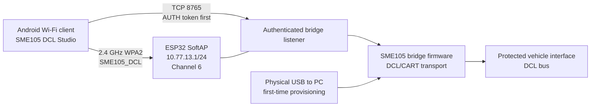

# SME105 Wi-Fi Bridge Architecture and Secure Setup

## Scope and compatibility status

The Wi-Fi firmware provides a direct, local SoftAP link for an Android client.
The ESP32 has no router, cloud service, or internet dependency in this topology.
USB is used for first-time provisioning and private token extraction; normal
Wi-Fi sessions use the ESP32's authenticated TCP listener.

The current Android workspace includes a native Wi-Fi transport, local
credential configuration, and the `AUTH` handshake described below. Use that
native app with the Wi-Fi-enabled `esp32dev` image. The separate
`esp32dev_ble` image is BLE only and disables Wi-Fi. Physical
phone-to-bridge acceptance remains required; joining the SoftAP alone does not
verify the app transport or authenticated session.

## Wi-Fi-first architecture and topology



The ESP32 creates a private WPA2 network with a default SSID of
`SME105_DCL`, fixed address `10.77.13.1/24`, channel 6, and TCP port 8765.
The SoftAP is configured for one associated client. It does not provide an
internet gateway. Android may display a “no internet” warning; keep the phone
connected to the device network while using the local bridge.

There are two independent credentials:

- The WPA2 password allows a device to associate with the SoftAP. It is
  provisioned over USB and stored in ESP32 NVS.
- The 128-bit bridge token authorizes the TCP control session. It is also
  stored in NVS and is returned only by the USB-only `WIFI_TOKEN` command.

The TCP client sends `AUTH <32-hex-token>` as its first line and must receive
`AUTH OK`. It must authenticate before requesting bridge state or issuing any
other protocol line. A failed or missing authentication is rejected before
commands are accepted. The token is not the WPA2 password and must never be
included in a transcript, screenshot, cloud backup, email, or chat message.

### USB provisioning protocol

For first-time AP setup, the host sends
`WIFI_AP_CONFIG <b64_ssid> <b64_pass>` over physical USB. The firmware checks
the values, stores the SSID, WPA2 password, and AP mode in NVS, then starts the
SoftAP. The host requires the exact acknowledgement
`WIFI_AP_CONFIG OK saved=1 starting=1`, polls `WIFI_AP_STATUS` until the AP
reports `10.77.13.1`, and only then requests `WIFI_TOKEN` over USB.

The current firmware's status line is shaped like:

```text
WIFI_AP_STATUS mode=AP state=ACTIVE ip=10.77.13.1 stations=0 channel=6 port=8765 wpa2=1
```

It reports `stations` and does not echo the SSID. The provisioning utility
also accepts the documented `clients`/`ssid` spelling for compatible firmware
revisions. Neither format contains the WPA2 password or TCP token.

AP credentials are write-once in the current firmware. If an AP credential
pair is already saved, `WIFI_AP_CONFIG` is refused to avoid partially
overwriting working NVS data. In `--ap` mode, the setup utility recognizes the
exact `DENIED wifi_ap_config_exists` reply, sends USB command `WIFI_AP_MODE`,
and accepts only `WIFI_AP_MODE OK starting=1` or `WIFI_AP_MODE OK`. It then
waits for AP readiness and retrieves the token over USB. This safely resumes
the saved AP without erasing or rotating NVS. The utility reports this reuse
and does not send a vehicle command. Use `WIFI_STA_MODE` only to select
previously saved router credentials. The host's `--replace-token` option only
replaces the local token file; it does not rewrite firmware credentials or
rotate the token.

## Firmware build compatibility

Build the firmware from `firmware/sme105_usb_bridge` with PlatformIO:

```bash
./.venv/bin/pio run -d firmware/sme105_usb_bridge -e esp32dev
./.venv/bin/pio run -d firmware/sme105_usb_bridge -e esp32dev_ble
```

| PlatformIO environment | Intended transport | Wi-Fi behavior | BLE behavior |
| --- | --- | --- | --- |
| `[env:esp32dev]` | Standard Wi-Fi bridge | SoftAP and STA support enabled | Disabled |
| `[env:esp32dev_ble]` | Separate BLE feasibility build | Explicitly disabled with `WiFi.mode(WIFI_OFF)` | NimBLE enabled |

These are separate firmware binaries, not runtime modes in one image. The
ESP32 uses one 2.4 GHz radio for Wi-Fi and Bluetooth and has limited SRAM.
Keeping the transports in separate builds avoids radio coexistence and memory
pressure in a timing-sensitive bridge. In the BLE build, the firmware calls
`WiFi.mode(WIFI_OFF)` and does not start the SoftAP or STA stack; AP setup
cannot make that binary Wi-Fi capable. Select the image that matches the
Android transport being tested.

## Secure first-time setup guide

### 1. Connect the bridge to the PC over USB

Connect the ESP32's physical USB serial port to a trusted PC. Use the device's
serial port (for example, `/dev/ttyUSB0` or `COM7`), not TCP. For initial
provisioning, use a bench setup with the vehicle bus disconnected and no active
bridge session or firmware update in progress. The utility verifies firmware
identity, bridge `STATUS`, and `PINS` before sending credentials.

### 2. Provision the SoftAP

From the repository root, run:

```bash
python scripts/sme105_wifi_setup.py --ap
```

The default SSID is `SME105_DCL`. To choose a different printable ASCII SSID,
use `--ap-ssid YOUR_SSID`. The WPA2 password is requested interactively and is
not echoed or accepted on the command line. The utility validates the SSID as
1–32 ASCII characters and the password as 8–63 printable ASCII characters.

The current firmware requires an AP WPA2 passphrase of at least 16 characters.
The utility accepts 16–63 printable ASCII characters, matching the firmware's
strict credential decoder. Use a randomly generated passphrase in that range.
If firmware rejects a password, the utility reports the rejection without
displaying it and does not retrieve or save the token.

If the firmware reports that SoftAP credentials already exist, the utility
resumes the saved AP with `WIFI_AP_MODE`; it does not erase or rotate those
credentials. The passphrase entered for this run is not applied to the saved
configuration. If firmware status does not include the saved SSID, the utility
will say that the SSID was not reported rather than guessing from
`--ap-ssid`.

After the firmware confirms the AP is active, the utility retrieves the token
over USB and writes it to the default path
`~/.config/sme105/bridge-token` with mode `0600`. Parent configuration
directories are created as needed. The file is refused if it already exists
unless `--replace-token` is explicitly supplied. The console confirms the
private file was written, then displays only the SSID, IP, and TCP port. It
never prints the WPA2 password or token.

### 3. Transfer the token to Android locally

Transfer the token from the PC to the phone over a trusted physical USB
connection, then enter it in the native app's **Settings → Wi-Fi Bridge →
Bridge Token** field and save it. Enter the SoftAP passphrase when Android
prompts to join the network. The native Android app stores both the WPA2
passphrase and bridge token in encrypted private app storage, protected by a
key held in Android Keystore. The token UI masks the entry and clears it after
saving. Keep the transfer offline: do not use email, messaging, cloud drives,
shared links, clipboard history, screenshots, or public/shared storage. If a
temporary phone-side file is needed, remove it after saving. Keep the PC token
file owner-only. Do not enter the token into the browser PWA, which does not
use the native secure storage path.

### 4. Associate the Android device directly

On Android, join the 2.4 GHz WPA2 network `SME105_DCL` using the password
entered at setup (or the custom `--ap-ssid` value). If Android asks whether to
stay connected without internet access, choose to remain on the device network.
The ESP32 is the access point at `10.77.13.1`; it has no upstream router or
cloud connection.

### 5. Connect the Wi-Fi-capable Android app and authenticate

In the native Android app, select Wi-Fi and SoftAP mode. Join `SME105_DCL`
when Android presents its local network request, then connect to
`10.77.13.1`, TCP port `8765`. The app reads the token from encrypted private
app storage and sends the `AUTH` line first. Continue only after an exact
`AUTH OK` response. The app's startup identity check uses `HELLO`, `PINS`,
and `STATUS`; it must not automatically arm or start a vehicle operation. A
successful authenticated session proves the local transport and authorization
path, not ECU behavior.

Do not paste the token into an ordinary terminal, log, URL, or diagnostic
export. Do not treat joining the AP or receiving `AUTH OK` as permission to
send a vehicle command.

## Hardware acceptance procedure

Record firmware environment/version, Android build, device, date, and result
for each stage. These checks require physical hardware. Software tests and
mock USB conversations do not count as a hardware pass.

### Stage A — USB provisioning and bench SoftAP

1. Keep the vehicle bus disconnected. Connect the bridge to the PC over USB
   and run `python scripts/sme105_wifi_setup.py --ap` with the Wi-Fi firmware.
2. Confirm the identity/STATUS/PINS checks pass, the AP configuration receives
   its positive acknowledgement, and the token file exists with mode `0600`.
3. From a separate Wi-Fi client, confirm `SME105_DCL` is visible and associate
   to it. Verify the client reaches `10.77.13.1` and TCP port `8765` is open.
4. Read USB `WIFI_AP_STATUS`; pass requires `mode=AP`, active address
   `10.77.13.1`, channel 6, port 8765, and WPA2 enabled.

### Stage B — Android authenticated session

1. Save the token in the native Android app's encrypted private storage and
   join the direct SoftAP when prompted.
2. Connect to `10.77.13.1:8765`. Confirm a valid token receives `AUTH OK`,
   then request `STATUS` and `PINS`. Confirm an invalid token is refused before
   any bridge command is accepted.
3. Disconnect and reconnect once, confirming authentication is required for
   the new TCP session. Keep the vehicle bus disconnected; send no ECU command.

Pass requires the complete phone-to-bridge Wi-Fi and authentication path on a
physical Android device. A simulated Wi-Fi peer or software test cannot
replace this stage.

### Stage C — installed hardware and field-link stability

Proceed only after the project's electrical and vehicle installation checks
are complete and the owner has authorized physical vehicle work. Follow
[`wiring-safety.md`](wiring-safety.md) and the bridge README for power,
grounding, transceiver, DE, and connector checks. Begin stationary in a safe
location with the engine off. Confirm the approved power source remains stable,
the phone stays associated at the intended working distance, and repeated
authenticated `STATUS` requests remain responsive without resets or AP loss.
Record the observed distance, environment, supply measurements, and any
disconnect/recovery events; do not infer range from a desk test.

This network acceptance stage does not validate DCL polarity, electrical
signal quality, an ECU response, or a diagnostic profile. Do not send active
vehicle commands as part of Wi-Fi acceptance. Any ECU communication needs its
own approved procedure and acceptance evidence. Until each physical stage is
performed and recorded, mark it **NOT VERIFIED**.
